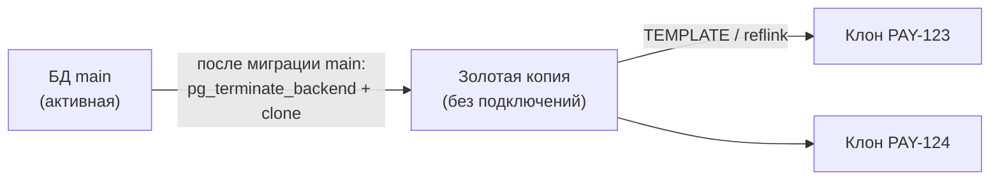

# Данные: клонирование и изоляция

Изоляция HTTP-запросов не означает изоляцию данных. Платформа должна явно определять, какие данные общие, а какие принадлежат фиче, и показывать это разработчику. **Приоритет: P0–P1.**

## Источники данных базового окружения

| Способ | Описание |
|---|---|
| Сид-скрипт | Хук проекта, генерирующий тестовые данные |
| Снапшот обезличенной БД | Собирается в CI клиента по правилам маскирования (имена, email, телефоны, платёжные данные); хранится в S3 клиента или у нас, зашифрован ключом команды. Продовые данные никогда не проходят через наши серверы в открытом виде |

Пустая база = пустой экран = смысл «открыть продукт в браузере» теряется. Данные — обязательная часть онбординга.

## Снапшоты: Team и Business

Базовый снапшот для онбординга нужен любой команде, поэтому он входит в Team. Управление множеством снапшотов и централизованный контроль ПДн — запрос компаний с требованиями ИБ, поэтому это Business.

| Возможность | Team (этап 2) | Business (этап 4) |
|---|---|---|
| Сборка `docklet snapshot build` в CI клиента | ✔ | ✔ |
| Правила маскирования в `workspace.yaml` (`data.snapshots.*.mask`) | ✔ — обязательны: без обезличивания нельзя | ✔ |
| Хранение: шифрование ключом команды, S3 клиента или наш | ✔ | ✔ |
| Автовосстановление при онбординге и `docklet db reset` | ✔ | ✔ |
| Версии | Один актуальный снапшот на проект (`latest`) + предыдущий для отката | Полная история с политикой хранения (retention) |
| Именованные снапшоты (воспроизведение бага, демо-данные, снапшот к ветке) | — | ✔ |
| Политики маскирования на уровне воркспейса: обязательные правила, которые проекты не могут ослабить | — | ✔ |
| Сканер ПДн: блокирует публикацию снапшота с немаскированными колонками, похожими на email/телефон/карту | — | ✔ |
| Аудит: кто собрал, кто скачал снапшот и на какое устройство | — (общий аудит-лог Team) | ✔ детальный |

Граница проходит по объёму и контролю, а не по безопасности: маскирование в Team обязательно, Business добавляет централизованное принуждение и проверку.

## Золотая копия

**Проблема:** `CREATE DATABASE … TEMPLATE` падает с `source database is being accessed by other users` — Postgres требует отсутствия подключений к шаблону, а базовое окружение работает всегда.

**Решение:**
1. После каждой миграции `main` агент создаёт свежую золотую копию из базовой БД: `ALTER DATABASE … ALLOW_CONNECTIONS false` → `pg_terminate_backend` → `CREATE DATABASE golden TEMPLATE … STRATEGY FILE_COPY` → `ALLOW_CONNECTIONS true`. На это время main недоступна: по замерам P-3 около 0,6 с на 1 ГБ без reflink (3,8 с на 5 ГБ) и около 0,2 с с reflink. Новые подключения в этот момент получают ошибку, а не ждут.
2. Фичи клонируются **только** из золотой копии; базовое окружение не трогается.
3. Золотая копия помечена версией миграций. Если клон или копия отстают — агент предупреждает и предлагает обновить.

## Скорость клонирования

Замеры прототипа [P-3](../../prototypes/p3-db-clone/README.md), Docker Desktop на Apple Silicon:

| Способ | 1 ГБ, ext4 | 1 ГБ, XFS reflink | 5 ГБ, ext4 | Место за клон |
|---|---|---|---|---|
| `STRATEGY WAL_LOG` (по умолчанию с PG 15) | 1,7–2,4 с | 2,1 с | 7,6 с | полная копия + WAL |
| `STRATEGY FILE_COPY` | 0,46–0,55 с | 0,67 с | 2,5 с | полная копия |
| PG 18: `FILE_COPY` + `file_copy_method = clone` | 0,42 с | **33 мс** | 3,0 с | с reflink — **0** до первых изменений |
| Копия всего `PGDATA` (отдельный инстанс) | 3,0 с | 54 мс | 11,3 с | полная копия + WAL + RAM на инстанс |

**Правила агента:**
- Стратегия всегда явная: `FILE_COPY`. `WAL_LOG` в 3–4 раза медленнее.
- На PG 18 всегда `SET file_copy_method = clone`. На reflink-ФС клон мгновенный, на ext4 Postgres использует `copy_file_range` и работает не медленнее `copy`.
- Без reflink цена клона — **место на диске**, а не время: каждый клон — полная копия. Бюджет ресурсов устройства учитывает диск.
- Перед клоном проверяем свободное место: без reflink нужно не меньше размера золотой копии плюс запас. При переполнении Postgres падает с неочевидной ошибкой (`buffer is pinned in InvalidateBuffer`).

NFR-2 («фича < 60 с с клоном БД до 1 ГБ») по части БД выполняется и на ext4 с запасом в сотню раз. Холодный кэш и базы больше RAM VM пока не мерили.

## MySQL

Аналога `TEMPLATE` нет. Варианты:
- copy-on-write снапшот volume при остановленном `mysqld` или после `FLUSH TABLES WITH READ LOCK`;
- отдельный инстанс на фичу, поднятый из снапшота;
- `mysqldump` для небольших баз как запасной путь.

Выбор зависит от ФС; открытый вопрос закрывается прототипом на этапе 0 (см. [ADR-0007](../../adr/0007-db-cloning.md)).

## Общие и собственные ресурсы

### Общий бэкенд пишет в общую БД

**Сценарий:** PAY-123 форкает платёжку, бэкенд берётся из main. Бэкенд пишет в базовую БД, общую для всех фич. Действия в PAY-123 видны в PAY-124 и в main.

**Причина:** одна `DATABASE_URL` не может зависеть от контекста запроса.

**Решение:**
- В модели фичи каждый ресурс помечается `shared` или `owned`. Панель показывает: «бэкенд и его БД общие с main».
- Если модуль пишет данные, которые проверяет фича, его нужно форкнуть вместе с БД. Платформа подсказывает это при создании фичи по графу `uses`.
- По умолчанию — отдельная **логическая БД** на фичу в общем инстансе MySQL/Postgres. Для проектов с жёстко заданным именем БД — отдельный инстанс.

### Рассинхрон данных и схем между форками

**Сценарии:**
- Форкнутая платёжка создаёт платёж в своём клоне, бэкенд из main ищет его в базовой БД и не находит.
- Платёжка в фиче мигрировала схему и изменила API, а бэкенд из main ждёт старый контракт.

**Решение:** явное, задокументированное ограничение режима с общими модулями. Рекомендация форкать связанные модули вместе. При изменении миграций или API-контракта в форке панель предупреждает, какие базовые модули от него зависят.

## Миграции

| Проблема | Решение |
|---|---|
| Две фичи мигрируют одну общую БД | Миграции фичи запускаются только на её клоне; на общей БД — блокировка и запрет |
| main мигрировал, клоны фич устарели | Агент показывает отставание схемы и предлагает пересоздать клон или догнать миграции |
| Разрушающая миграция в фиче | Клон пересоздаётся из золотой копии одной кнопкой |

## Прочие хранилища (не покрыто источниками — требует проработки)

| Хранилище | Предлагаемое поведение по умолчанию |
|---|---|
| Redis | Отдельная логическая БД (`/N`) или префикс ключей на фичу; для очередей — префикс обязателен |
| MinIO (S3) | Отдельный bucket-префикс на фичу; копирование объектов — по запросу |
| Mailpit | Общий инстанс, письма фильтруются по фиче (тег/заголовок) |
| Elasticsearch / поиск | Индекс с префиксом фичи; переиндексация — хук проекта |
