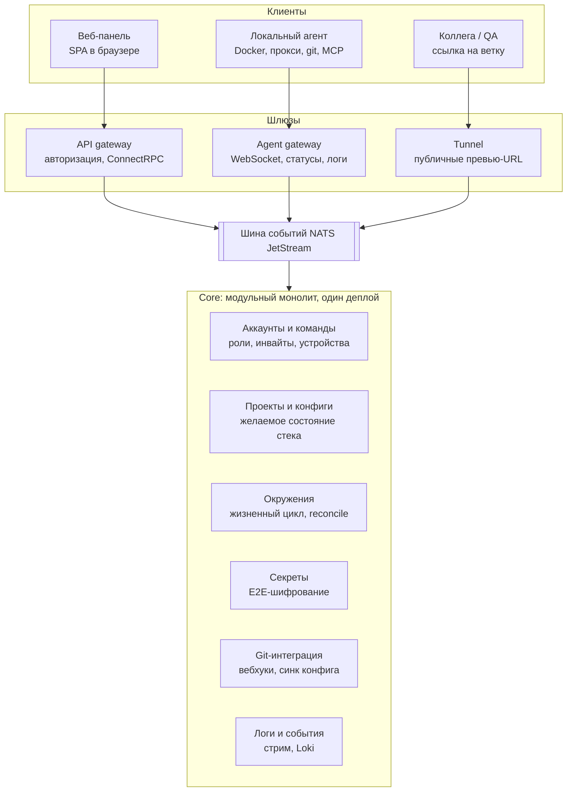
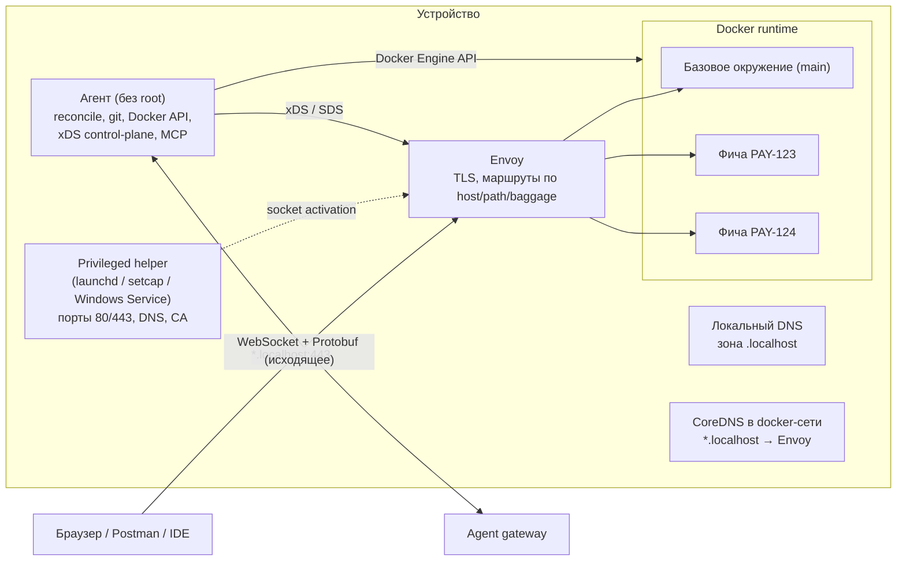
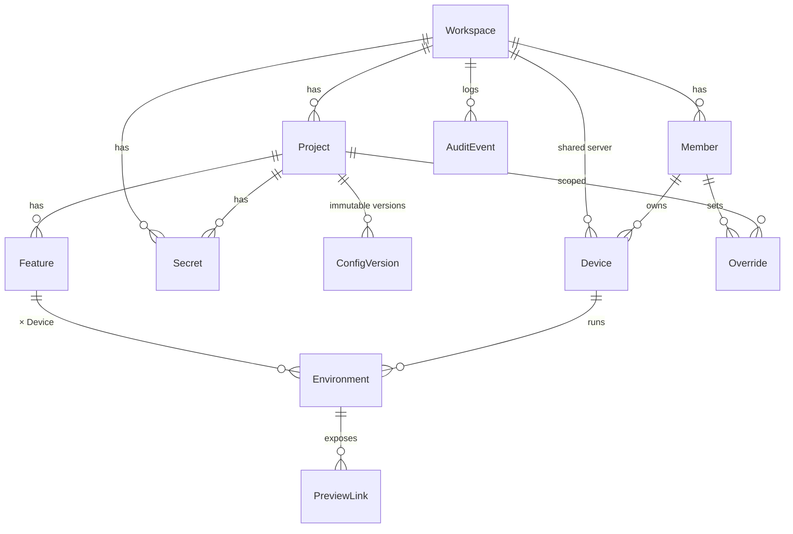

# Архитектура: обзор

## Компоненты

Запросы идут сверху вниз: клиенты подключаются только к шлюзам; шлюзы и модули ядра общаются через NATS. Модули ядра изолированы схемами в Postgres и внутренними интерфейсами — любой позже выносится в отдельный сервис без переписывания.

## Деплои на старте: три, а не девять

| Деплой | Что внутри | Почему отдельно |
|---|---|---|
| **Core** | Модульный монолит: API gateway, аккаунты, проекты, окружения, секреты, git-интеграция | Модули со своими схемами в одной Postgres; выносятся позже почти механически |
| **Agent gateway** | WebSocket-соединения агентов, стрим логов | Stateful, тысячи долгих соединений, масштабируется иначе |
| **Tunnel** | Публичные превью-ссылки (на основе frp или свой на QUIC) | Весь трафик превью; его падение не должно задеть панель |

Логи на старте пишутся из Agent gateway напрямую в Loki, без отдельного сервиса.

## Локальная часть (на устройстве)

Подробнее: [agent.md](agent.md), [local-networking.md](local-networking.md), [docker-isolation.md](docker-isolation.md).

## Модель данных

Ключевая идея — разделение **желаемого** состояния (версия конфига, фичи) и **фактического** (окружения на устройствах). Сервис окружений постоянно сравнивает их и отдаёт агентам разницу.

| Сущность | Ключевые поля | Связи | Модуль ядра |
|---|---|---|---|
| Workspace | название, тариф, публичная часть ключа шифрования | Members, Projects, Devices | Аккаунты |
| Member | пользователь, роль (owner / admin / developer / viewer) | в Workspace; владеет Devices | Аккаунты |
| Device | ОС, версия агента, ресурсы, публичный ключ, статус | Member или Workspace (общий сервер) | Аккаунты |
| Project | имя, домен, репозиторий конфига | в Workspace; ConfigVersions, Features | Проекты |
| ConfigVersion | содержимое `workspace.yaml`, автор, git-коммит | в Project; неизменяемая | Проекты |
| Secret | имя, зашифрованное значение, версия | Workspace или Project | Секреты |
| Feature | имя, ветка, форкнутые модули, ссылка на задачу, режим изоляции | в Project; автор Member или AI-агент | Окружения |
| Environment | тип (base / feature), desired/actual state, версия конфига, URL, ID | Feature (или база) × Device | Окружения |
| Override | поле, значение | Member × Project | Проекты |
| PreviewLink | публичный URL, срок, доступ | Environment | Tunnel |
| AuditEvent | кто, что, когда, на каком устройстве | Workspace | Логи и события |

**Environment — центральная сущность:** одна запись на пару «фича × устройство»; её статусы питают панель, контроль расхождений и автоочистку.

Дополнения из технического разбора, которые нужно отразить в модели:
- `Environment.id` — стабильный ID, используемый во всех Docker-ресурсах (Compose project, volumes, метки).
- `Feature.resources[]` — для каждого модуля/БД пометка `shared | owned` (см. [data.md](data.md)).
- `Feature.isolation_mode` — `simple | contextual`.
- `Environment.schema_lag` — отставание миграций клона от золотой копии.

## Сквозной пример: «создать окружение для ветки»

1. Пользователь нажимает кнопку в панели; API gateway вызывает сервис окружений.
2. Сервис окружений сохраняет запись `Environment(desired=running)` и публикует в NATS «окружение X должно существовать на устройстве Y».
3. Agent gateway (тот инстанс, где висит соединение устройства, топик `device.<id>`) отправляет агенту новый `DesiredState`.
4. Агент: `git worktree add`, клон БД, контейнеры, сертификат, маршрут в Envoy.
5. `StatusReport` идёт обратно той же цепочкой, панель показывает прогресс в реальном времени.

Если соединение оборвалось посреди операции — после переподключения агент сверится с актуальным состоянием и доделает.

## Данные платформы

| Что | Где |
|---|---|
| Основная БД | PostgreSQL, отдельная схема на модуль ядра |
| Онлайн-статусы агентов | Redis/Valkey с TTL |
| Логи окружений | Loki на старте, ClickHouse при росте |
| Снапшоты БД, образы проектов | S3-совместимое хранилище + OCI-реестр (клиента или наш, зашифровано ключом команды) |
| Фоновые задачи | River (очередь поверх Postgres) |
