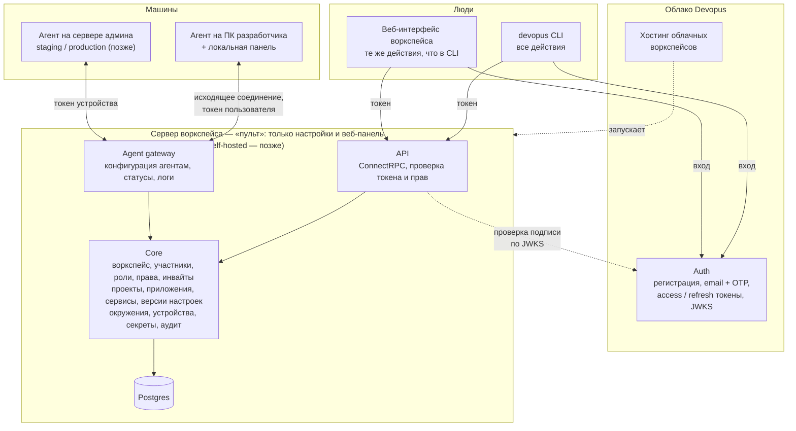
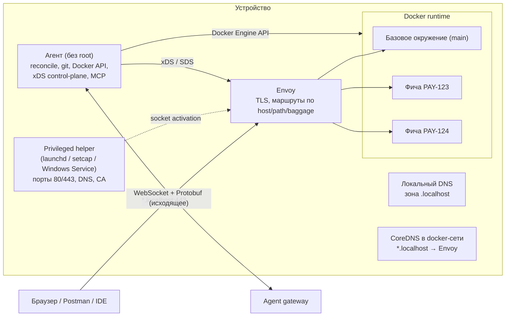
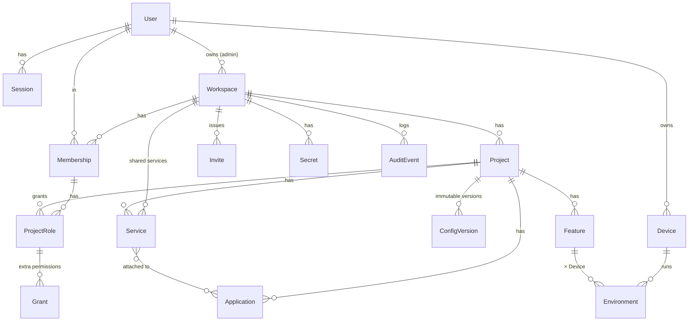

# Архитектура: обзор

> Переписано 16.10.2026 под модель «воркспейс → проект → приложение → сервисы; настройки на сервере Devopus; приложения разворачивают агенты; роли и права» ([vision](../product/vision.md), [ADR-0013](../../adr/0013-config-on-workspace-server.md)…[ADR-0016](../../adr/0016-workspace-server.md)). Локальная часть — движок этапа 1 — не меняется.

## Компоненты

| Компонент | Где работает | Что делает | Документ |
|---|---|---|---|
| **Auth** | Облако Devopus, один на всех | Аккаунты, регистрация и вход по email + одноразовому коду, сессии, токены, тарифный план аккаунта | [auth.md](auth.md), [ADR-0014](../../adr/0014-auth-service.md) |
| **Сервер воркспейса** (`devopus server`) | У нас (сайт Devopus); позже — self-hosted у клиента | «Пульт»: API для CLI и веб-панели, права, настройки проектов, приложений и сервисов, раздача их агентам, аудит. Проекты здесь не запускаются | [ADR-0016](../../adr/0016-workspace-server.md) |
| **Агент** (`devopus agent`) | ПК разработчиков; позже — серверы админа (staging, production) | Единственный исполнитель: приводит Docker, git, прокси и данные к настройкам; фичи, клоны баз, сон и пробуждение | [agent.md](agent.md) |
| **CLI** (`devopus`) | Везде | Единая точка управления: всё, что есть в продукте | [specs/cli.md](../../specs/cli.md), [ADR-0012](../../adr/0012-devopus-cli-control-point.md) |
| **Веб-панель воркспейса** | Отдаёт сервер воркспейса (сайт Devopus) | Те же действия, что в CLI, с теми же правами | этап 3+ |
| **Локальная панель** (`devopus panel`) | ПК разработчика, `127.0.0.1` | Окружения этой машины | [ADR-0012](../../adr/0012-devopus-cli-control-point.md) |
| **Tunnel** | Облако или self-hosted | Публичные превью-ссылки на окружения | позже |

Внутри сервера воркспейса — модульный монолит ([ADR-0002](../../adr/0002-modular-monolith-three-deploys.md)): модули со своими схемами в Postgres; Agent gateway выносится отдельно, когда понадобится масштабировать долгие соединения.

## Как действие проходит через систему

Пример: тимлид меняет версию PHP в проекте `drive` (php подключён к `backend` и `admin`).

1. `devopus service set drive php 8.4` → CLI берёт access-токен (обновив его refresh-токеном, если истёк) и вызывает API сервера воркспейса.
2. API проверяет подпись токена по ключам Auth и право `services.manage` пользователя в проекте `drive`.
3. Core сохраняет новую неизменяемую версию настроек проекта и событие аудита.
4. Agent gateway отправляет новое желаемое состояние агентам всех устройств, где есть проект `drive`: ПК разработчиков, позже — серверы админа.
5. Агенты применяют его с учётом личных переопределений `devopus.local.yaml`, на которые у пользователя есть право, и отправляют статусы. Веб-интерфейс показывает, где уже применено.

Если агент был offline, он получает актуальную версию при переподключении: желаемое состояние, а не команды ([ADR-0001](../../adr/0001-desired-state-reconciliation.md)).

## Локальная часть (на устройстве)

Подробнее: [agent.md](agent.md), [local-networking.md](local-networking.md), [docker-isolation.md](docker-isolation.md).

## Модель данных

| Сущность | Ключевые поля | Где хранится |
|---|---|---|
| User | email, имя, тарифный план (для админа) | Auth |
| Session | устройство, создана, последняя активность, refresh-токен (хеш), отозвана | Auth |
| Workspace | имя, владелец (админ, один; передаётся), размещение (облако / self-hosted), адрес сервера, план | Auth (реестр) + сервер воркспейса |
| Membership | пользователь, воркспейс, админ ли | Сервер воркспейса |
| ProjectRole | участник, проект, роль (teamlead / developer) | Сервер воркспейса |
| Grant | право сверх роли (`services.manage`…), кто выдал | Сервер воркспейса |
| Invite | email, роль, проекты, кто выдал, срок, принят ли | Сервер воркспейса |
| Project | имя (продукт: Google Drive), домен, политика фич и переопределений | Сервер воркспейса |
| Application | имя (frontend, backend), репозиторий, основная ветка, маршруты, хуки | Сервер воркспейса |
| Service | проект, тип (php, nodejs, mysql, redis, typesense, queue, cronjob…), версия, настройки, приложения, к которым подключён (одно или несколько) | Сервер воркспейса |
| ConfigVersion | снимок проекта: приложения и сервисы, автор, время, комментарий | Сервер воркспейса, неизменяемая |
| Device | владелец (пользователь), роль машины (рабочая / сервер для staging и production), ОС, версия агента, публичный ключ | Сервер воркспейса |
| Environment | проект, base / feature / staging / production, устройство, желаемое и фактическое состояние, версия конфигурации, переопределения | Сервер воркспейса (статус); само окружение — только на устройстве |
| Feature | проект, имя, ветка, приложения-форки, автор (человек или AI-агент) | Сервер воркспейса |
| Secret | имя, зашифрованное значение, проект | Сервер воркспейса (E2E) |
| AuditEvent | кто, что, где, когда | Сервер воркспейса |

**Права проверяются только на сервере воркспейса** по Membership, ProjectRole и Grant. Токен Auth говорит только, кто пользователь.

## Данные платформы

| Что | Где |
|---|---|
| Основная БД | PostgreSQL, отдельная схема на модуль ядра |
| Онлайн-статусы агентов | Redis/Valkey с TTL |
| Логи окружений | Loki на старте, ClickHouse при росте |
| Снапшоты БД, образы приложений | S3-совместимое хранилище + OCI-реестр (клиента или наш, зашифровано ключом команды) |
| Фоновые задачи | River (очередь поверх Postgres) |
