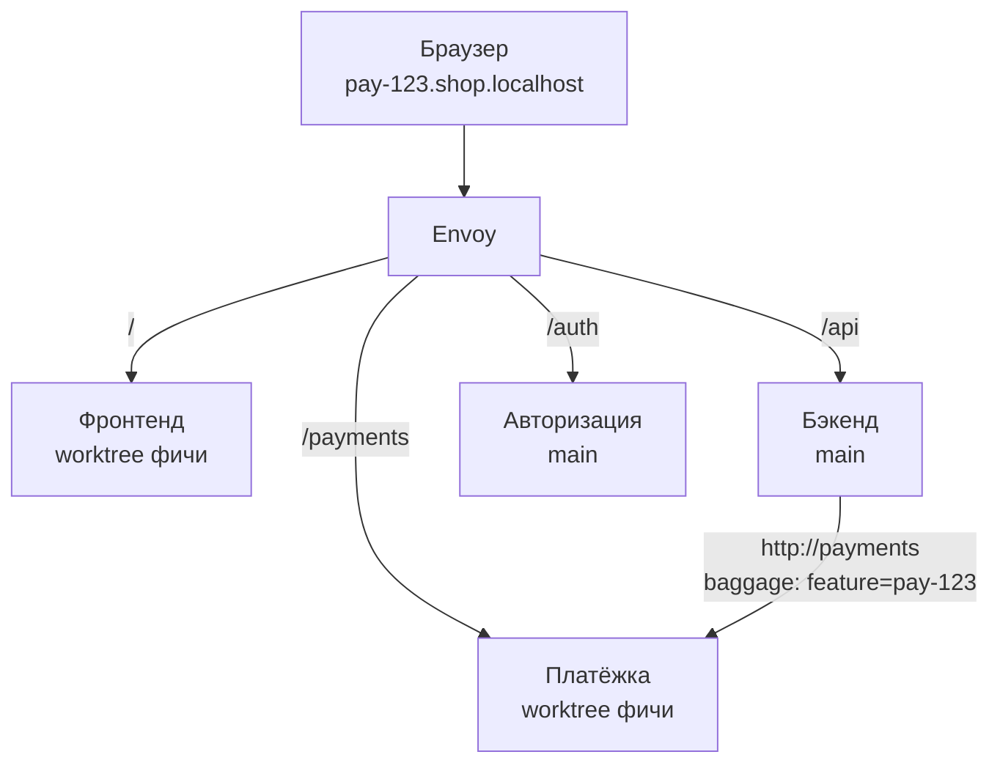

# Маршрутизация

Фича форкает только выбранные модули; остальные запросы уходят в базовое окружение (main). Маршрут выбирает **прокси по контексту фичи**, а не env-переменные. Это request-level isolation (как Signadot, mirrord, внутренние системы на Kubernetes), перенесённая на локальный Docker.

Один Envoy на устройство, на одном порту, маршрутизация по hostname + path (+ baggage). Отдельный прокси на проект не нужен.

## Два режима изоляции

| Режим | Как работает | Когда |
|---|---|---|
| **Simple Isolation** | Фича получает свои контейнеры для изменённых модулей **и зависимых модулей/сервисов**; адреса — через ссылки `${{payments.url}}` в env; затронутые контейнеры перезапускаются при изменении состава фичи | MVP (этап 1), legacy-проекты, модули с WebSocket/gRPC/TCP |
| **Contextual Isolation** | Envoy маршрутизирует по контексту фичи (W3C Baggage); базовые модули общие | Этап 3, проекты с проверенной передачей контекста |

Simple дороже по ресурсам, но предсказуема. Прототип Contextual — уже на этапе 0: это главная гипотеза отличия.

## Слой 1. Браузер → модули: same-origin по пути

У фичи один адрес `pay-123.shop.localhost`; фронтенд ходит в API по относительным путям (`/api`, `/auth`, `/payments`). Envoy для каждого пути выбирает форк фичи, если он есть, иначе базовую версию.

Плюсы: фронтенд не знает ни одного хоста; нет CORS и проблем с доменами cookies.

Таблица маршрутов строится из `modules.*.routes` (longest prefix match). Хост определяет окружение: `<slug>.<project-domain>` → фича, `<project-domain>` → база, `<service>.<slug>.<domain>` → `expose` сервиса.

## Слой 2. Модуль → модуль: стабильные имена + контекст

- В env всегда логическое имя: `PAYMENTS_URL=http://payments`. Оно никогда не меняется.
- Имя резолвится во внутренний листенер Envoy (алиас в docker-сети).
- Контекст передаётся в заголовке `baggage: feature=pay-123`. Автоинструментация OpenTelemetry (PHP, Python, Node) пробрасывает его даже через неизменённые базовые модули.
- Envoy: если `baggage.feature` указывает на фичу, у которой есть форк модуля → форк, иначе → база.

### Что нужно агенту выставить

- `OTEL_PROPAGATORS=tracecontext,baggage` во всех контейнерах.
- PHP: расширение `ext-opentelemetry` в образ рантайма (в стандартных образах его нет) и инструментация фреймворка (`opentelemetry-auto-slim`, Laravel, PSR-15): на голом PHP-скрипте контекст входящего запроса извлекать некому.
- **Никогда не `OTEL_TRACES_EXPORTER=none`.** В Node (`auto-instrumentations-node` 0.50) это молча выключает передачу контекста ([P-5](../../prototypes/p5-baggage/README.md)). Если проекту трейсы не нужны — `OTEL_TRACES_SAMPLER=always_off`. Если в проекте уже настроен свой OpenTelemetry, агент только добавляет пропагатор `baggage`.
- Готовые образы рантаймов с проверенными версиями OTel: зависимости хрупкие (например, `opentelemetry-instrument` 0.48b0 падает без `setuptools`).

Прототип P-5 подтвердил схему на Node (`http`, `fetch`), Python (Flask + `requests`) и PHP (Slim + Guzzle): неизменённый модуль main, вызванный из фичи, попадает в форк. Envoy добавляет около 0,1 мс на внутренний вызов.

## Слой 3. Асинхронные потоки

| Поток | Решение |
|---|---|
| Очереди (Redis, RabbitMQ) | Заголовок не попадает в сообщение, а голые списки Redis не инструментированы | Нужны правки в проекте или SDK платформы: отправитель кладёт контекст в сообщение и выбирает очередь по таблице форков (`jobs:<feature>`, только если у фичи свой воркер), воркер восстанавливает контекст из сообщения. Проверено в P-5. Celery, BullMQ, Sidekiq имеют свою инструментацию — не проверено |
| Cron | Запускается только у форкнутых модулей, чтобы две копии не делали одну работу |
| Callback внешнего сервиса (вебхуки, OAuth) | Wildcard-домен или Tunnel + callback-брокер, разводящий по фичам. ⚠ Раздел 8.4 с описанием брокера в исходном документе отсутствует — см. [risks](../../risks-and-open-questions.md) |
| WebSocket, gRPC, прямой TCP | Не поддерживается в Contextual Isolation; такие модули работают в Simple |

## Защита заголовка от подмены

Если Envoy принимает `baggage: feature=…` от клиента как есть, любой клиент направит запрос в чужую фичу — в командном режиме с превью-ссылками это уязвимость.

**Правило:** на входной границе (внешний листенер, Tunnel) Envoy **удаляет** входящий baggage-ключ фичи и выставляет его сам по хосту и правам доступа. Внутри docker-сети доверяется только baggage, выставленный прокси. Удалять нужно только ключ `feature`, а не весь заголовок: проекты могут пользоваться baggage сами. Штатные `request_headers_to_remove` умеют только весь заголовок — нужен Lua-фильтр или ext_proc (P-5).

## Проверка распространения контекста

Агент отправляет пробный запрос с меткой через всю цепочку модулей и смотрит в трейсах OpenTelemetry (локальный collector), где метка пропала. Панель показывает модуль, на котором контекст теряется, и предлагает переключить фичу в Simple Isolation.

## Где теряется контекст

| Где | Почему | Решение |
|---|---|---|
| Нестандартный HTTP-клиент | Не покрыт автоинструментацией | Проверка в панели, ручная обёртка |
| PHP | Нет `ext-opentelemetry` | Платформа добавляет расширение в образ |
| Пропагаторы | Baggage передаётся, только если включён его пропагатор | `OTEL_PROPAGATORS=tracecontext,baggage` |
| Очереди | Заголовок не попадает в сообщение | Контекст в сообщении + очередь с префиксом |
| Cron | Нет входящего запроса | Только у форков |
| WebSocket/gRPC/TCP | Не HTTP или нет инструментации | Simple Isolation |
| Callback извне | Контекст не возвращается | Callback-брокер |

## Требования к проектам

- Фронтенд берёт адрес API как относительный путь или из runtime-конфига; `VITE_API_URL` и аналоги, зашитые в сборку, — антипаттерн. Платформа детектирует и предупреждает.
- Сервисы пробрасывают заголовки трассировки; платформа проверяет и предупреждает.
- OAuth redirect URI и вебхуки — на wildcard-домен или через Tunnel.
- Legacy-проекты без этого — Simple Isolation с генерацией env через `${{payments.url}}`.

## Ограничение: маршрутизация изолирует запросы, но не данные

См. [data.md](data.md#общий-бэкенд-пишет-в-общую-бд). В Contextual Isolation общий бэкенд пишет в общую БД — действия в PAY-123 видны в PAY-124 и в main.
