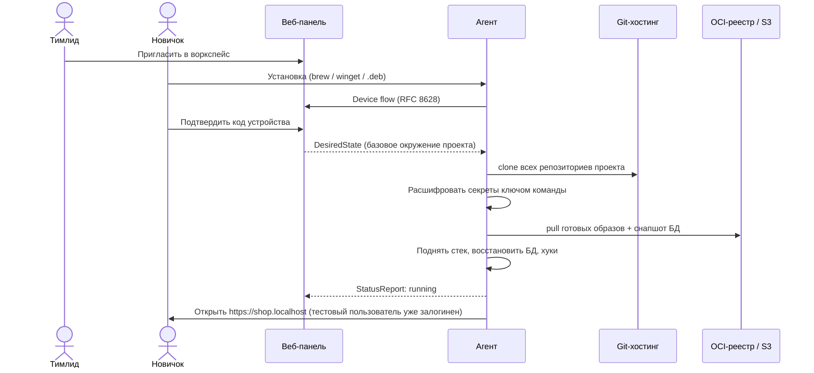
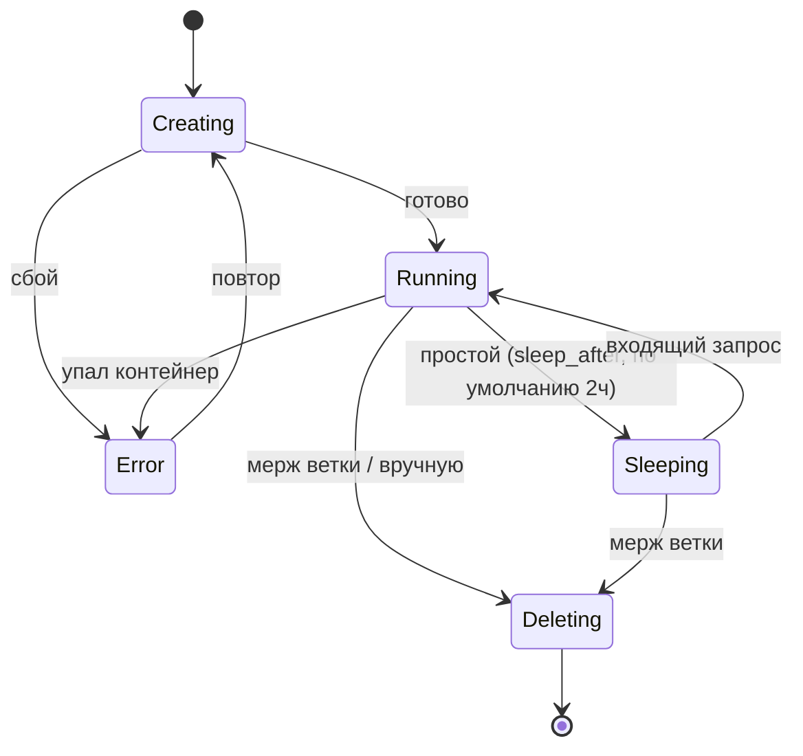

# Пользовательские сценарии

## 1. Онбординг нового разработчика (этап 2)

**Цель:** новичок открывает локальную версию продукта в браузере через минуты после приглашения, ничего не настраивая руками. Целевое время — **< 15 минут** при канале 100 Мбит/с и готовых образах.

**Условия для 15 минут:**
- Образы проекта заранее собираются в CI клиента и кладутся в реестр — агент только скачивает.
- Снапшот обезличенной БД готовится в CI клиента по правилам маскирования.
- Preflight-проверки (Docker, порты, DNS, CA) проходят автоматически или с одним подтверждением админ-прав.

**Метрика** time-to-first-page считается от события `member.invited` до первого `environment.first_request` и показывается в панели.

> Открытый вопрос: доставка ключа команды на новое устройство (см. [security.md](../architecture/security.md#доставка-ключа-команды-на-новое-устройство)).

## 2. Локальный старт без команды (MVP, этап 1)

1. `brew install docklet` → агент регистрируется как служба.
2. `docklet init` в папке проекта: импорт `docker-compose.yml` → черновик `workspace.yaml`.
3. `docklet up` → preflight (Docker runtime, порты 80/443, DNS `*.localhost`, CA) → базовое окружение на `shop.localhost`.
4. Локальная веб-панель агента показывает статус окружений.

## 3. Создание фичи

1. Разработчик в панели/CLI/MCP создаёт фичу (`PAY-123`) или она создаётся из задачи Jira/Linear/GitHub Issues.
2. Выбирает модули, которые будет менять (например, `frontend`, `payments`).
3. Платформа по графу `uses` подсказывает: «`backend` и его БД будут общими с main. Если фича проверяет данные, которые пишет backend — форкните его вместе с БД» (см. [data.md](../architecture/data.md)).
4. Агент:
   - создаёт `git worktree` с веткой `feature/PAY-123` в каждом выбранном репозитории;
   - клонирует БД форкнутых модулей из **золотой копии**;
   - поднимает только контейнеры форков (в Simple Isolation — ещё и зависимые модули);
   - выпускает TLS-сертификат и регистрирует хост `pay-123.shop.localhost` в Envoy.
5. Панель показывает прогресс в реальном времени и итоговый URL. Цель — **< 60 с** при 2 форках и БД до 1 ГБ.
6. Позже модуль добавляется в фичу одной кнопкой — маршруты перестраиваются автоматически.

**Через MCP** (этап 3): AI-агент вызывает `create_feature(task, modules)` → получает путь к worktree и URL окружения.

## 4. Жизненный цикл окружения

| Процесс | Поведение |
|---|---|
| **Усыпление** | Нет запросов через прокси И нет изменений файлов в worktree в течение `sleep_after` → агент останавливает контейнеры. Данные и worktree остаются |
| **Пробуждение** | Первый запрос прокси удерживает и показывает страницу «запускаемся»; агент поднимает контейнеры. Цель < 10 с |
| **Автоочистка** | Вебхук о мерже PR → удаление фичи на всех устройствах. Перед удалением worktree — проверка незакоммиченных и незапушенных изменений; при наличии — подтверждение |
| **Бюджет ресурсов** | Лимит одновременно работающих фич и памяти на устройство; при превышении засыпает самая давно неактивная. Базовое окружение не засыпает никогда |

## 5. Контроль расхождений (этап 2)

- Агент регулярно сообщает фактическое состояние; панель показывает расхождения: «у Анны MySQL 5.7 вместо 8.4», «отключён Redis», «окружение не обновлялось 7 дней».
- Изменение конфига командой (например, добавили Elasticsearch) раскатывается всем автоматически, с уведомлением.
- Личные переопределения (Xdebug, другой порт) разрешены только из списка `overrides.allowed`, явные и видны в панели.
- Двусторонняя синхронизация: правка в панели → коммит в репозиторий конфига; правка файла → обновление панели.

## 6. Превью-ссылка (этап 2)

Коллега или QA открывает `pay-123.team.<домен>.dev` → Tunnel → агент на машине разработчика → Envoy. Ссылка имеет срок жизни и правила доступа. Envoy на входе удаляет внешний `baggage` с ключом фичи и выставляет его сам.

## 7. Удаление устройства

Админ в панели отзывает устройство одним кликом → токен агента аннулируется, `device.revoked` → агент при следующем подключении получает отказ и прекращает синхронизацию секретов. Ключ команды ротируется (см. security).
