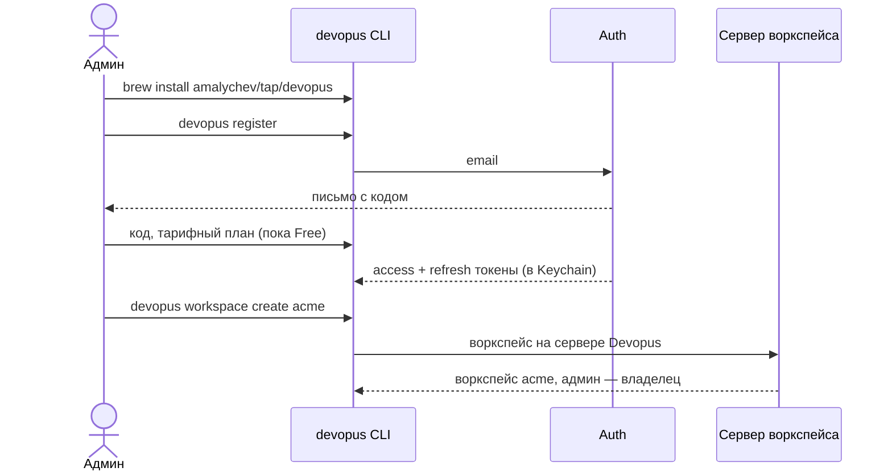
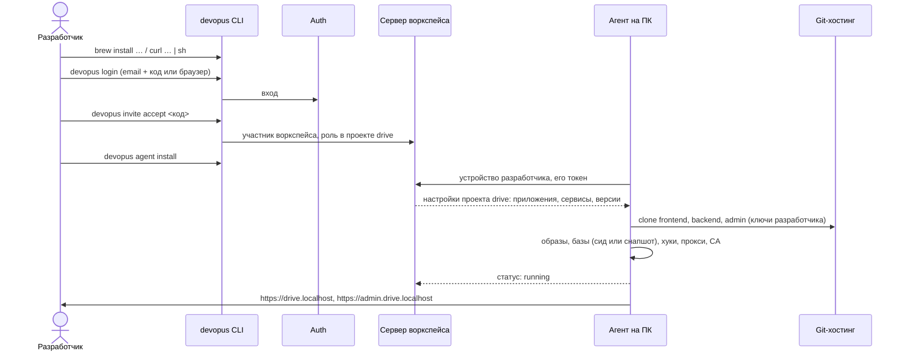

# Пользовательские сценарии

Модель — с 16.10.2026: **воркспейс → проект → приложение → сервисы** (Google → Google Drive → frontend, backend); роли; настройки на сервере Devopus; приложения разворачивают агенты ([vision](vision.md), [роли](roles.md)). Каждый сценарий сначала делается командами `devopus`, потом повторяется в веб-панели с теми же правами.

## 1. Регистрация админа и первый воркспейс



- Воркспейс готов сразу: настройки и веб-панель на сайте Devopus. Self-hosted («пульт» на своём сервере) — после облачной версии ([ADR-0016](../../adr/0016-workspace-server.md)).
- У админа может быть несколько воркспейсов: `devopus workspace list`, `devopus workspace use <имя>`.

## 2. Проект, приложения и сервисы (админ или тимлид)

```bash
devopus project create drive                                   # проект: продукт компании
devopus app add drive frontend --repo git@github.com:acme/drive-frontend.git
devopus app add drive backend  --repo git@github.com:acme/drive-backend.git
devopus app add drive admin    --repo git@github.com:acme/drive-admin.git

# сервисы живут в проекте и подключаются к одному или нескольким приложениям
devopus service add drive nodejs 22     --apps frontend
devopus service add drive php 8.3       --apps backend,admin
devopus service add drive mysql 8.4     --apps backend,admin
devopus service add drive redis 7       --apps backend
devopus service add drive typesense 30.2 --apps backend
devopus service add drive queue   --apps backend --command "php artisan queue:work" --replicas 2
devopus service add drive cronjob --apps backend --schedule "* * * * *" --command "php artisan schedule:run"
devopus service link drive redis admin  # подключить существующий сервис ещё к одному приложению

devopus project config show drive                              # настройки проекта в YAML
```

- Проект можно создать импортом: `devopus project create drive --from-compose docker-compose.yml` — сервисы compose становятся приложениями и сервисами.
- Каждое изменение — новая версия настроек проекта на сервере воркспейса. Агенты участников получают её сами (сценарий 5).

## 3. Инвайт

1. Админ: `devopus invite create anna@acme.dev --role teamlead --project drive --project gmail`.
   Тимлид: `devopus invite create ivan@acme.dev --role developer --project drive` (только разработчиков и только в свои проекты).
2. Приглашённому приходит письмо с кодом инвайта.
3. Права сверх роли выдаются сразу или позже: `devopus member grant ivan@acme.dev services.manage --project drive`.

## 4. Онбординг разработчика

**Цель:** от принятия инвайта до открытой страницы — **меньше 15 минут**, ничего не настраивая руками.



Ни `init`, ни `workspace.yaml`, ни ручных секретов. Нет доступа к какому-то репозиторию — агент говорит, к какому, и что попросить у админа.

## 5. Изменение серверной среды и раскатка

1. Тимлид меняет версию: `devopus service set drive php 8.4` — у всех приложений, к которым подключён php.
2. Сервер воркспейса сохраняет новую версию настроек проекта и записывает в аудит, кто и что поменял.
3. Агенты всех разработчиков проекта получают её и пересобирают окружения. Те, кто сейчас offline, — при следующем подключении.
4. В веб-панели видно, у кого уже применено, у кого ещё нет и у кого стоит личное переопределение.

## 6. Личное переопределение

Разработчик не согласен с версией сервиса или ему нужна другая настройка — только у себя:

```yaml
# devopus.yaml в папке приложения backend (в .gitignore, в git не попадает)
services:
  php:
    version: "8.4"     # пробую миграцию на 8.4
```

- Агент применяет переопределение поверх настроек проекта, если у пользователя есть право `overrides.use`, а политика проекта разрешает менять это поле. Иначе — не применяет и объясняет почему.
- Переопределение видно в веб-панели как расхождение. Тимлид может принять его в настройки проекта (тогда оно будет у всех) или запретить.
- `devopus project config show drive --effective` — что реально применяется у этого разработчика.

## 7. Фича (ядро этапа 1)

1. `devopus feature create PAY-123 --apps backend,frontend` в проекте `drive`, или из веб-панели, или через MCP у AI-агента.
2. Агент создаёт worktree на ветке `feature/PAY-123` в каждом выбранном приложении, клонирует базы из золотой копии и поднимает контейнеры фичи.
3. Адрес — `https://pay-123.drive.localhost`; остальные приложения фича берёт у базового окружения проекта.
4. Фича засыпает без активности и просыпается первым запросом; удаляется после мержа с проверкой несохранённой работы.

## 8. Staging и production на сервере админа (позже)

Сервер админа — такая же машина, как ПК разработчика: на нём работает агент, а не «пульт» воркспейса.

1. Админ на своём сервере: `brew install …` или `curl … | sh`, затем `devopus login`.
2. `devopus agent install --server` — агент системной службой, с токеном устройства.
3. `devopus env create staging --project drive --branch main` (или `production`) — проект со всеми приложениями разворачивается по тем же настройкам, что у разработчиков, с публичным адресом и настоящими сертификатами.
4. Изменения настроек доходят и сюда — с подтверждением для production.

## 9. Сессии и выход

- Сессия живёт, пока ей пользуются: 30 дней без активности или 90 дней всего, потом `devopus login` заново.
- `devopus auth sessions` — свои сессии на устройствах, `devopus auth revoke <id>` — отозвать, `devopus logout` — выйти здесь.
- Удалённый из воркспейса участник теряет доступ сразу: сервер отказывает его токенам и устройствам, агент перестаёт получать настройки.

## 10. Без воркспейса — нельзя

Все команды, кроме `register`, `login`, `version` и `help`, требуют входа и работают в воркспейсе. Режима без воркспейса нет: даже один человек создаёт свой воркспейс и становится его админом. Для отладки и разработки самого Devopus есть **демо-воркспейс** с проектом из [examples/demo](../../examples/demo) ([ADR-0013](../../adr/0013-config-on-workspace-server.md)).
