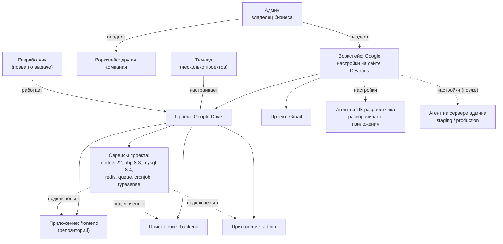

# Видение продукта

> Переписано 16.10.2026 по модели владельца продукта: воркспейс → проект → приложение → сервисы; роли; настройки на сервере Devopus; проекты разворачивают агенты; авторизация. Решения — [ADR-0013](../../adr/0013-config-on-workspace-server.md) … [ADR-0016](../../adr/0016-workspace-server.md).

## Проблема

- **У всех разное окружение.** У одного разработчика настроен Mailtrap, у другого нет; у одного стоит Typesense, у другого нет; у кого-то PHP 8.2, у кого-то 8.3. Отсюда «у меня работает, а у тебя нет».
- **Онбординг занимает дни.** Новичок неделю собирает проект у себя: репозитории, версии рантаймов, базы, очереди, крон, заглушки внешних сервисов.
- **Нет одного хозяина окружения.** Описание стека разбросано по README, compose-файлам и головам. Изменить окружение всей команды может только каждый у себя руками.
- **Серверная среда живёт отдельно от локальной.** Staging настраивают одни люди, локальные окружения — другие, и они расходятся.

## Решение

**Devopus — централизованное управление окружением разработки всей команды.** Админ и тимлиды описывают серверную среду воркспейса: проекты, их приложения, сервисы, версии и настройки. У каждого разработчика она автоматически появляется на ПК и обновляется сама.

Новый разработчик:
1. принимает инвайт и входит (`devopus login`);
2. ставит Devopus (`brew` или `curl`);
3. агент разворачивает проекты и приложения, к которым у него есть доступ, и он сразу начинает работать.

Сверх этого остаётся ядро этапа 1: **отдельное изолированное окружение на каждую ветку и каждого AI-агента**, со своими данными и своим адресом, локально в Docker.

## Модель

| Понятие | Что это | Пример |
|---|---|---|
| **Воркспейс** | Компания админа: проекты, участники и права. Его **настройки и веб-панель живут на сервере Devopus** (на сайте); позже — по желанию на своём сервере (self-hosted), для тех, кто опасается утечки данных. Приложения на этом сервере не запускаются. У админа может быть несколько воркспейсов | Google |
| **Проект** | Продукт компании: набор приложений, которые работают вместе. У проекта свои тимлиды и разработчики | Google Drive |
| **Приложение** | Часть проекта, обычно один git-репозиторий | frontend, backend, admin, widget |
| **Сервис** | Всё, из чего собирается окружение: рантаймы (php, nodejs), хранилища (mysql, redis, typesense), фоновые процессы (queue, cronjob), вспомогательные (mailtrap). У сервиса — тип, версия и настройки. **Сервис существует в рамках проекта и подключается к одному или нескольким его приложениям**: php — к backend и admin, одна mysql — к backend и admin, nodejs — к frontend | `php 8.3` → backend, admin |
| **Серверная среда** | Настройки проектов, приложений и сервисов: версии, параметры. Ими управляют админ и тимлиды; агенты по ним разворачивают окружения на ПК разработчиков, а позже — на серверах админа (staging, production) | «backend: php 8.3, queue ×2» |
| **Агент** | Devopus на машине (`brew`/`curl`): по настройкам воркспейса разворачивает приложения. Единственное место, где они запускаются | `devopus agent` |

Подробнее — [глоссарий](glossary.md), [роли и права](roles.md).

## Принципы

1. **Всё через `devopus`, потом то же в веб-интерфейсе.** Любое действие сначала появляется командой CLI, затем экраном веб-интерфейса с теми же правами ([ADR-0012](../../adr/0012-devopus-cli-control-point.md)).
2. **Сначала авторизация.** Без входа `devopus` ничего не делает; что можно, решает роль и выданные права ([ADR-0014](../../adr/0014-auth-service.md), [ADR-0015](../../adr/0015-roles-and-permissions.md)).
3. **Источник правды — настройки воркспейса на сервере, а не файл в репозитории.** YAML нужен, чтобы посмотреть конфигурацию и переопределить её у себя личным файлом `devopus.local.yaml`, если разработчик не согласен ([ADR-0013](../../adr/0013-config-on-workspace-server.md)). Режима без воркспейса нет: даже один человек работает через свой воркспейс.
4. **Код и данные не покидают машины команды.** Исходники и базы окружений живут только там, где работают агенты; на сервере Devopus — только настройки, секреты зашифрованы. Для полной приватности — self-hosted.
5. **Без lock-in.** Агент открытый (Apache 2.0); импорт из `docker-compose.yml` и экспорт обратно; self-hosted сервер воркспейса.

## Целевой клиент

| Роль | Зачем ему Devopus |
|---|---|
| **Админ** (владелец бизнеса, CTO) — покупатель | Одинаковое окружение у всей команды, быстрый онбординг, контроль доступа; позже — staging и production на своих серверах тем же инструментом |
| **Тимлид** | Управляет окружением своих проектов (и их приложений) из одного места; изменения сразу у всей команды |
| **Разработчик** | Вошёл — и работает; отдельное окружение на каждую ветку и AI-агента |

Сегмент: команды 5–100 разработчиков с продуктами из нескольких приложений-репозиториев — продуктовые компании (несколько проектов в воркспейсе), агентства с множеством клиентов (у админа несколько воркспейсов или проект на клиента), команды с AI-агентами.

## Конкуренты и отличия

| Категория | Примеры | Чего не хватает |
|---|---|---|
| Локальные окружения | DDEV, Lando, Laravel Herd, Dev Containers | Уровень одного репозитория; нет хозяина окружения, ролей, синхронизации на всю команду |
| Облачные среды | Codespaces, Gitpod, Coder | Код и база в чужом облаке, оплата за часы; локальной работы нет |
| PaaS и self-hosted PaaS | Railway, Render, Coolify, Dokploy | Про серверы и production, а не про окружение разработчиков |
| Оркестраторы AI-агентов | Conductor, Vibe Kanban | Dev-сервер на порту, а не полный стек с данными |

**Отличие:** одни настройки окружения на всю команду, которыми управляют админ и тимлиды по ролям, автоматически повторяются на каждом ПК — с изолированными окружениями на ветку и клонами данных; позже — те же настройки на staging и production.

## Бизнес-модель

Сейчас всё бесплатно. При регистрации админ выбирает тарифный план; планы — гипотеза для проверки на пилотах.

| План | Что входит | Статус |
|---|---|---|
| **Free** | Облачный воркспейс с ограничениями (участники, проекты), все роли | Доступен с этапа 2 |
| **Team** | Облачный воркспейс без ограничений, секреты, снапшоты данных, превью-ссылки | Позже |
| **Self-hosted** | Настройки и веб-панель воркспейса на своём сервере; учётные записи — в Devopus | После облачной версии; выбирается при регистрации |
| **Enterprise** | SSO/SAML, аудит, Auth внутри инсталляции, SLA | Позже |

Агент и CLI — открытые и бесплатные.

## Метрики успеха

| Метрика | Цель / смысл |
|---|---|
| **Time-to-first-page** — от принятия инвайта до первой открытой страницы приложения | < 15 минут; показывается в веб-интерфейсе |
| Расхождения окружений участников с серверной средой | Стремится к нулю |
| Активные участники в неделю | Доля от приглашённых |
| Фичи на разработчика в неделю | Включая фичи AI-агентов |
| Воркспейсы на админа, конверсия в платные планы | Монетизация |
