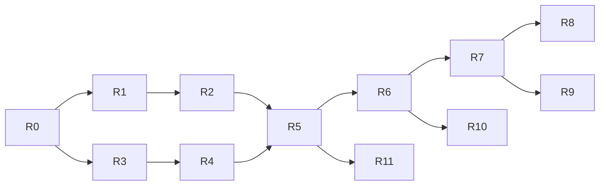

# План рефакторинга под новую модель

**Составлен 16.10.2026.** Цель — перевести код v0.1.0 (локальный движок) на модель из [vision](product/vision.md): вход и роли; настройки воркспейса и веб-панель на сервере Devopus; проекты (продукты) из приложений-репозиториев; сервисы проекта с версиями, подключённые к приложениям; проекты разворачивают только агенты; режима без воркспейса нет ([ADR-0013](../adr/0013-config-on-workspace-server.md) … [ADR-0016](../adr/0016-workspace-server.md)). Этапы продукта — [roadmap](../roadmap.md); этот документ — порядок работ в коде.

## Принципы

1. **Движок не ломаем.** Сеть, прокси, CA, контейнеры, фичи, клоны баз, сон и пробуждение (≈ 13 тыс. строк в `internal/agent`) работают и проверены на трёх runtime. Меняется то, откуда движок берёт описание стека и кто им управляет.
2. **Каждый шаг заканчивается рабочим `main`:** тесты зелёные, демо поднимается, CI проходит. Нет долгих веток.
3. **Сначала модель и названия, потом новые сервисы.** Модель: воркспейс → проект → приложения и сервисы. «Проект» этапа 1 им и остаётся; переименовать нужно только «модуль → приложение» и добавить уровень воркспейса — дешевле всего сейчас, пока кода мало и пользователей нет.
4. **Совместимость с v0.1.0 не нужна.** Пользователей нет; `workspace.yaml` v1 уходит (остаётся только как внутренний источник демо-воркспейса), импорт — из `docker-compose.yml`. Исправления v0.1.x, если понадобятся, — в ветке `release/0.1`.
6. **Всё проверяем локально.** До выбора домена и хостинга Auth и сервер воркспейса работают на Mac разработчика, письма с кодом пишутся в лог.
5. **Права проверяются в одном месте** — на сервере воркспейса; каждая команда и каждый RPC объявляют нужное право.

## Что остаётся, что меняется, что новое

| Пакет | Строк | Судьба |
|---|---|---|
| `internal/agent/runtime`, `proxy`, `pki`, `git`, `lifecycle` | ≈ 5 100 | **Остаются** как есть: Docker, Envoy, CA, worktree, сон и пробуждение не зависят от модели |
| `internal/daemon`, `internal/service`, `internal/trust`, `internal/panel` | ≈ 1 250 | **Остаются**: компоненты, службы, CA, локальная панель |
| `internal/agent/stack` | 1 700 | **Меняется:** строит контейнеры из новой модели `internal/spec`; знание о типах баз и рантаймов уезжает в каталог сервисов |
| `internal/agent/reconcile` | 4 000 | **Меняется по названиям** (модуль → приложение) и источнику: желаемое состояние приходит с сервера |
| `internal/agent/store`, `api`, `client` | 1 600 | **Меняются:** локальное состояние становится кешем полученного с сервера; RPC переименовываются |
| `proto/devopus/agent/v1` | — | **Меняется:** `agent/v2` с новыми названиями; плюс новые `auth/v1`, `workspace/v1`, `sync/v1` |
| `internal/workspace` (`workspace.yaml` v1) | 1 400 | **Уходит:** парсер v1 → `internal/spec` остаётся только для демо-воркспейса; валидатор и `init`/`validate` — убираются |
| `internal/compose` | 1 400 | **Остаётся импортом:** compose → `internal/spec` (сейчас → `workspace.yaml`) |
| `internal/cli` | 3 500 | **Меняется:** вход перед командами, новые группы `workspace`, `project`, `service`, `invite`, `member`; `init`, `validate`, `export`, `schema` убираются |
| `web/` (панель) | 4 000 | **Делится:** общие компоненты + локальная панель + веб-интерфейс воркспейса |
| `internal/spec`, `internal/catalog` | — | **Новые:** модель воркспейс → проект → сервис и каталог типов сервисов |
| `internal/auth`, `cmd/devopus-auth` | — | **Новые:** сервис Auth |
| `internal/server` | — | **Новый:** сервер воркспейса (`devopus server run`) |

## Целевая раскладка репозитория

| Путь | Что |
|---|---|
| `cmd/devopus` | Один бинарник: CLI, `agent run`, `panel run`, `server run` (сервер воркспейса — «пульт»; в облаке и, позже, self-hosted) |
| `cmd/devopus-auth` | Сервис Auth — отдельный деплой только в облаке Devopus |
| `internal/spec` | Модель: Workspace → Project → Applications и Services (сервис проекта подключается к нескольким приложениям), политики; YAML-представление для `config show` и личного `devopus.local.yaml` |
| `internal/catalog` | Типы сервисов (php, nodejs, python, mysql, postgres, redis, typesense, mailpit, queue, cronjob): образ по версии, порты, healthcheck, где данные, как клонировать |
| `internal/importer` | `docker-compose.yml` → `internal/spec` (бывший `compose`); `workspace.yaml` v1 → `spec` — только для демо-воркспейса |
| `internal/agent/…` | Движок, как сейчас; `sync` — соединение с сервером воркспейса |
| `internal/auth` | OTP, письма, токены, сессии, JWKS, реестр воркспейсов |
| `internal/server` | API, проверка прав, воркспейсы, участники, инвайты, проекты, сервисы, версии конфигурации, секреты, аудит, Agent gateway |
| `internal/authz` | Список прав, роли по умолчанию, проверка — общая для сервера и CLI (подсказки) |
| `internal/credentials` | Хранение и обновление токенов на устройстве (Keychain / Secret Service) |
| `proto/devopus/{agent/v2,auth/v1,workspace/v1,sync/v1}` | Контракты |
| `web/packages/ui`, `web/apps/panel`, `web/apps/workspace` | Общие компоненты, локальная панель, веб-интерфейс воркспейса |

## Шаги

Каждый шаг — один или несколько PR; «Готово, когда» — критерий приёмки. Этап — этап [roadmap](../roadmap.md).

### R0 · Подготовка — этап 2 ✅ 16.10.2026

- Закоммитить документацию новой модели; ветка `release/0.1` от тега `v0.1.0`.
- В CI: `buf lint` и проверка, что `gen/` совпадает с `proto/`. Тест «демо поднимается» в CI пока нет: на раннерах GitHub нет Docker для macOS, а Linux-хост не проверен — демо и сквозные тесты гоняются локально.
- Убрать мусор тестов: пустые каталоги `internal/agent/reconcile/shop/*`.
- Переименовать Go-модуль в `github.com/amalychev/devopus`: путь совпадёт с репозиторием, заработает `go install`.

**Готово, когда:** `main` = документы новой модели, CI зелёный.

**Сделано:** ветка `release/0.1` от `v0.1.0`; Go-модуль — `github.com/amalychev/devopus` (импорты, `buf.gen.yaml`, `gen/`, ldflags релиза); задача `proto` в CI; пустые каталоги `internal/agent/reconcile/shop` от старой версии теста удалены (нынешние тесты их не создают).

### R1 · Новая модель и каталог сервисов — этап 2

- `internal/spec`: Workspace → Projects; у проекта — Applications (репозитории) и Services; сервис существует в проекте и подключается к одному или нескольким его приложениям; политики фич и переопределений.
- `internal/catalog`: типы сервисов с версиями. Рантайм (`runtime: php:8.3`), воркеры и cron из `workspace.yaml` v1 становятся сервисами проекта `php`, `queue`, `cronjob`, подключёнными к приложению. Распознавание баз по образу из `stack` переезжает в каталог.
- `internal/importer`: `workspace.yaml` v1 и compose → `spec`; отчёт A/B/C остаётся.
- `stack` строит план из `spec`.

**Готово, когда:** демо и все сквозные тесты (`TestAgentEndToEnd`, `TestFeatures`, `TestFeatureData`, `TestFeatureSleep`) проходят на `spec`, полученном импортом `workspace.yaml` v1; корпус P-8 импортируется как раньше.

### R2 · Переименование в агенте, протоколе, CLI и панели — этап 2

- `proto/devopus/agent/v2`: модули → приложения (`AddFeatureModules` → `AddFeatureApps`, `ModuleInfo` → `AppInfo`, `ModuleSource` → `AppSource`…); `ProjectSpec` остаётся и получает воркспейс; `Up` принимает `spec`, а не байты YAML.
- `reconcile`, `store`, `api`: те же названия; формат `state.json` — v2. Старое состояние агент не читает и предлагает `devopus agent uninstall --purge`.
- CLI: `feature create --apps backend,frontend` вместо `-m`; тексты; `--json` с новыми полями.
- Панель: дерево «воркспейс → проект → окружения», «приложения» вместо «модулей».

**Готово, когда:** в коде, протоколе, CLI и панели нет слов модели этапа 1, кроме импорта v1; сквозные тесты зелёные.

### R3 · Auth — этап 2

- `cmd/devopus-auth`, `internal/auth`: Postgres (pgx + sqlc, миграции goose); регистрация и вход по email и OTP; access JWT (Ed25519, 15 минут), refresh с ротацией и обнаружением повторного использования; сессии; JWKS; реестр воркспейсов пользователя; выбор плана (только Free).
- Письма через интерфейс: SMTP-провайдер в облаке, вывод в консоль в разработке.
- `proto/devopus/auth/v1`; лимиты на OTP по email, IP и устройству.
- Локальный запуск для разработки: Auth и Postgres на Mac, письма с кодом — в лог. Домен, хостинг и почтовый провайдер — позже.

**Готово, когда:** регистрация, вход, обновление, повторное использование refresh, отзыв сессии покрыты тестами на настоящем Postgres; весь сценарий проходит локально.

### R4 · Вход в CLI — этап 2

- `internal/credentials`: refresh-токен в Keychain / Secret Service, access — в памяти; автоматическое обновление.
- Команды `register`, `login [--email|--device]`, `logout`, `whoami`, `auth sessions`, `auth revoke`; вход через браузер с PKCE и обратным вызовом на `127.0.0.1`.
- Вход обязателен для всех команд, кроме `register`, `login`, `version`, `help`, `completion`; код выхода 5.
- Агент получает сессию пользователя при `agent install` и обновляет токены сам.

**Готово, когда:** без входа команды отказывают с понятным сообщением; после входа работает всё, что было в v0.1.0.

### R5 · Сервер воркспейса: участники и права — этап 2

- `devopus server run`, `internal/server`: Postgres; проверка access-токена по JWKS Auth; `internal/authz` — права, роли по умолчанию, `Grant`; объявление права у каждого RPC (опция в proto) и общий перехватчик.
- Воркспейсы, участие, роли в проектах, права, инвайты, аудит; `proto/devopus/workspace/v1`.
- CLI: `workspace create/list/use/show/transfer`, `invite create/list/revoke/accept`, `member list/grant/revoke/remove`.
- Одна общая инсталляция с `workspace_id` во всех таблицах; self-hosted — тот же бинарник с одним воркспейсом (R12). Один админ на воркспейс, `workspace transfer`.

**Готово, когда:** тест матрицы «роль × право × действие» проходит для каждого RPC; админ создаёт воркспейс и приглашает тимлида, тимлид — разработчика; разработчик без права получает отказ и в CLI, и при прямом вызове API.

### R6 · Проекты, сервисы и версии конфигурации — этап 3

- На сервере: проекты (домен, политика), приложения (репозиторий, ветка, маршруты, хуки), сервисы проекта с подключением к приложениям, неизменяемые версии настроек проекта, откат; проверка по `internal/catalog`.
- CLI: `project create [--from-compose]`, `project list/show/config show/history/rollback`, `app add/set/rm/list --repo`, `service add/set/rm/list/link/unlink --apps`.
- **Демо-воркспейс** из [examples/demo](../examples/demo): создаётся одной командой для разработки и отладки.
- YAML-представление конфигурации (`config show -o yaml`).

**Готово, когда:** демо-воркспейс создаётся одной командой, его настройки показываются и откатываются.

### R7 · Агент получает конфигурацию с сервера — этап 3

- `proto/devopus/sync/v1` и Agent gateway ([agent-protocol](../specs/agent-protocol.md)): исходящее соединение агента, желаемое состояние, статусы, логи по запросу.
- Сервер собирает желаемое состояние устройства: проекты, к которым у пользователя есть доступ.
- Локальный `store` — кеш последней конфигурации: без сети агент работает с ней.
- `devopus up` поднимает проекты текущего воркспейса; фичи пока создаются на устройстве и сообщаются серверу.
- Код клонируется с git-доступом самого разработчика; нет доступа — понятная подсказка, что попросить у админа.

**Готово, когда:** сценарий онбординга ([user-flows §4](product/user-flows.md#4-онбординг-разработчика)) проходит на чистой машине меньше чем за 15 минут; `service set` тимлида доходит до агентов участников без их действий; отключение сети не роняет окружения.

### R8 · Секреты — этап 3

- E2E по [ADR-0009](../adr/0009-secrets-key-distribution.md): ключ воркспейса, доставка на устройство, ротация; `secrets set/list/rm/rotate`.
- Агент расшифровывает секреты у себя; `.env.secrets` уходит вместе с режимом без воркспейса.

**Готово, когда:** проект с паролем базы разворачивается у нового участника без ручных секретов; сервер не видит значения.

### R9 · Переопределения и расхождения — этап 3

- Личный `devopus.local.yaml` в папке проекта (агент проверяет, что он в `.gitignore`): подмножество `internal/spec`; политика проекта и право `overrides.use`.
- Агент применяет разрешённое, отклоняет остальное с объяснением, сообщает расхождения; `devopus drift`; `project config show --effective`.

**Готово, когда:** разработчик с правом поднимает у себя PHP 8.4 файлом `devopus.local.yaml`, тимлид видит это в `drift`; без права — отказ с объяснением.

### R10 · Режим без воркспейса уходит — этап 3

- Убрать `init`, `validate`, `export compose`, `schema` и работу с `workspace.yaml` в папке; `up`/`down` — по воркспейсу; справка и `--help` по новой модели.
- Сквозные тесты движка переходят на демо-воркспейс.

### R11 · Веб-интерфейс воркспейса — этапы 3–4

- `web/` → общий пакет компонентов + локальная панель + веб-панель воркспейса, которую отдаёт сервер воркспейса (сайт Devopus).
- Этап 3: вход, воркспейсы, участники, инвайты, права (CLI этапа 2). Этап 4: проекты, сервисы, конфигурация, расхождения (CLI этапа 3).
- Те же RPC и те же права, что у CLI.

### Дальше: этапы 4–5

- **R12** (этап 4) — self-hosted: `devopus server install/upgrade/backup` на Ubuntu.
- **R13–R14** (этап 5) — серверы админа: `devopus agent install --server` с токеном устройства, `env create staging|production` с ACME и откатом.

Планируются после R11.

## Порядок и зависимости

R1–R2 (модель) и R3–R4 (Auth) не зависят друг от друга и могут идти параллельно. Сервер воркспейса (R5) начинается, когда готовы и модель, и вход.

## Как проверяем

- **Каждый шаг:** `go test -race ./...`, сквозные тесты движка на Docker Desktop (Colima и OrbStack — перед закрытием этапа), демо поднимается.
- **Auth и сервер:** тесты на настоящем Postgres (контейнер в тесте), без моков базы.
- **Права:** таблица «роль × право × RPC» генерируется из объявлений и проверяется целиком; отдельный тест — что каждый RPC объявил право.
- **Сценарии:** регистрация → воркспейс → инвайт → онбординг → `service set` → раскатка; гоняется скриптом на чистой машине перед закрытием этапа.

## Решено до начала (16.10.2026)

Ответы на вопросы модели M1–M9 — в [рисках](../risks-and-open-questions.md#открытые-вопросы-модели-161026). Для кода главное:

- сервер воркспейса — только настройки и веб-панель; окружения — только у агентов (R5–R7);
- иерархия воркспейс → проект → приложения и сервисы; сервис существует в проекте и подключается к нескольким приложениям (R1, R6);
- переопределения — только личный `devopus.local.yaml` (R9);
- режима без воркспейса нет, отладка — на демо-воркспейсе (R6, R10);
- один админ на воркспейс с передачей владения, без роли «только чтение» (R5);
- домен, хостинг и почта — позже; этапы 2–3 делаем и проверяем локально (R3);
- Go-модуль переименовываем в `github.com/amalychev/devopus` (R0).
