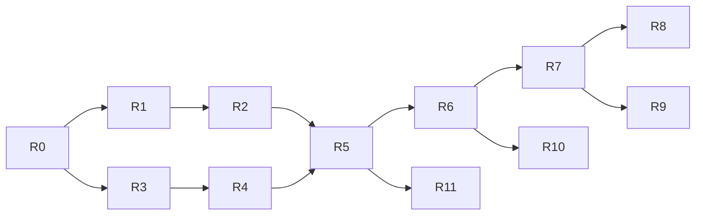

# План рефакторинга под новую модель

**Составлен 16.10.2026.** Цель — перевести код v0.1.0 (локальный движок) на модель из [vision](product/vision.md): вход и роли; настройки воркспейса и веб-панель на сервере Devopus; проекты (продукты) из приложений-репозиториев; сервисы проекта с версиями, подключённые к приложениям; проекты разворачивают только агенты; режима без воркспейса нет ([ADR-0013](../adr/0013-config-on-workspace-server.md) … [ADR-0016](../adr/0016-workspace-server.md)). Этапы продукта — [roadmap](../roadmap.md); этот документ — порядок работ в коде.

## Принципы

1. **Движок не ломаем.** Сеть, прокси, CA, контейнеры, фичи, клоны баз, сон и пробуждение (≈ 13 тыс. строк в `internal/agent`) работают и проверены на трёх runtime. Меняется то, откуда движок берёт описание стека и кто им управляет.
2. **Каждый шаг заканчивается рабочим `main`:** тесты зелёные, демо поднимается, CI проходит. Нет долгих веток.
3. **Сначала модель и названия, потом новые сервисы.** Модель: воркспейс → проект → приложения и сервисы. «Проект» этапа 1 им и остаётся; переименовать нужно только «модуль → приложение» и добавить уровень воркспейса — дешевле всего сейчас, пока кода мало и пользователей нет.
4. **Совместимость с v0.1.0 не нужна.** Пользователей нет; `workspace.yaml` v1 уходит (остаётся только как внутренний источник демо-воркспейса), импорт — из `docker-compose.yml`. Исправления v0.1.x, если понадобятся, — в ветке `release/0.1`.
6. **Всё проверяем локально.** До выбора домена и хостинга Auth и сервер воркспейса работают на Mac разработчика, письма с кодом пишутся в лог.
5. **Права проверяются в одном месте** — на сервере воркспейса; каждая команда и каждый RPC объявляют нужное право.

## Что остаётся, что меняется, что новое

| Пакет | Строк | Судьба |
|---|---|---|
| `internal/agent/runtime`, `proxy`, `pki`, `git`, `lifecycle` | ≈ 5 100 | **Остаются** как есть: Docker, Envoy, CA, worktree, сон и пробуждение не зависят от модели |
| `internal/daemon`, `internal/service`, `internal/trust`, `internal/panel` | ≈ 1 250 | **Остаются**: компоненты, службы, CA, локальная панель |
| `internal/agent/stack` | 1 700 | **Меняется:** строит контейнеры из новой модели `internal/spec`; знание о типах баз и рантаймов уезжает в каталог сервисов |
| `internal/agent/reconcile` | 4 000 | **Меняется по названиям** (модуль → приложение) и источнику: желаемое состояние приходит с сервера |
| `internal/agent/store`, `api`, `client` | 1 600 | **Меняются:** локальное состояние становится кешем полученного с сервера; RPC переименовываются |
| `proto/devopus/agent/v1` | — | **Меняется:** `agent/v2` с новыми названиями; плюс новые `auth/v1`, `workspace/v1`, `sync/v1` |
| `internal/workspace` (`workspace.yaml` v1) | 1 400 | **Уходит:** парсер v1 → `internal/spec` остаётся только для демо-воркспейса; валидатор и `init`/`validate` — убираются |
| `internal/compose` | 1 400 | **Остаётся импортом:** compose → `internal/spec` (сейчас → `workspace.yaml`) |
| `internal/cli` | 3 500 | **Меняется:** вход перед командами, новые группы `workspace`, `project`, `service`, `invite`, `member`; `init`, `validate`, `export`, `schema` убираются |
| `web/` (панель) | 4 000 | **Делится:** общие компоненты + локальная панель + веб-интерфейс воркспейса |
| `internal/spec`, `internal/catalog` | — | **Новые:** модель воркспейс → проект → сервис и каталог типов сервисов |
| `internal/auth`, `cmd/devopus-auth` | — | **Новые:** сервис Auth |
| `internal/server` | — | **Новый:** сервер воркспейса (`devopus server run`) |

## Целевая раскладка репозитория

| Путь | Что |
|---|---|
| `cmd/devopus` | Один бинарник: CLI, `agent run`, `panel run`, `server run` (сервер воркспейса — «пульт»; в облаке и, позже, self-hosted) |
| `cmd/devopus-auth` | Сервис Auth — отдельный деплой только в облаке Devopus |
| `internal/spec` | Модель: Workspace → Project → Applications и Services (сервис проекта подключается к нескольким приложениям), политики; YAML-представление для `config show` и личного `devopus.yaml` |
| `internal/catalog` | Типы сервисов (php, nodejs, python, mysql, postgres, redis, typesense, mailpit, queue, cronjob): образ по версии, порты, healthcheck, где данные, как клонировать |
| `internal/importer` | `docker-compose.yml` → `internal/spec` (бывший `compose`); `workspace.yaml` v1 → `spec` — только для демо-воркспейса |
| `internal/agent/…` | Движок, как сейчас; `sync` — соединение с сервером воркспейса |
| `internal/auth` | OTP, письма, токены, сессии, JWKS, реестр воркспейсов |
| `internal/server` | API, проверка прав, воркспейсы, участники, инвайты, проекты, сервисы, версии конфигурации, секреты, аудит, Agent gateway |
| `internal/authz` | Список прав, роли по умолчанию, проверка — общая для сервера и CLI (подсказки) |
| `internal/credentials` | Хранение и обновление токенов на устройстве (Keychain / Secret Service) |
| `proto/devopus/{agent/v2,auth/v1,workspace/v1,sync/v1}` | Контракты |
| `web/packages/ui`, `web/apps/panel`, `web/apps/workspace` | Общие компоненты, локальная панель, веб-интерфейс воркспейса |

## Шаги

Каждый шаг — один или несколько PR; «Готово, когда» — критерий приёмки. Этап — этап [roadmap](../roadmap.md).

### R0 · Подготовка — этап 2 ✅ 16.10.2026

- Закоммитить документацию новой модели; ветка `release/0.1` от тега `v0.1.0`.
- В CI: `buf lint` и проверка, что `gen/` совпадает с `proto/`. Тест «демо поднимается» в CI пока нет: на раннерах GitHub нет Docker для macOS, а Linux-хост не проверен — демо и сквозные тесты гоняются локально.
- Убрать мусор тестов: пустые каталоги `internal/agent/reconcile/shop/*`.
- Переименовать Go-модуль в `github.com/amalychev/devopus`: путь совпадёт с репозиторием, заработает `go install`.

**Готово, когда:** `main` = документы новой модели, CI зелёный.

**Сделано:** ветка `release/0.1` от `v0.1.0`; Go-модуль — `github.com/amalychev/devopus` (импорты, `buf.gen.yaml`, `gen/`, ldflags релиза); задача `proto` в CI; пустые каталоги `internal/agent/reconcile/shop` от старой версии теста удалены (нынешние тесты их не создают).

### R1 · Новая модель и каталог сервисов — этап 2 ✅ 16.10.2026

- `internal/spec`: Workspace → Projects; у проекта — Applications (репозитории) и Services; сервис существует в проекте и подключается к одному или нескольким его приложениям; политики фич и переопределений.
- `internal/catalog`: типы сервисов с версиями. Рантайм (`runtime: php:8.3`), воркеры и cron из `workspace.yaml` v1 становятся сервисами проекта `php`, `queue`, `cronjob`, подключёнными к приложению. Распознавание баз по образу из `stack` переезжает в каталог.
- `internal/importer`: `workspace.yaml` v1 и compose → `spec`; отчёт A/B/C остаётся.
- `stack` строит план из `spec`.

**Готово, когда:** демо и все сквозные тесты (`TestAgentEndToEnd`, `TestFeatures`, `TestFeatureData`, `TestFeatureSleep`) проходят на `spec`, полученном импортом `workspace.yaml` v1; корпус P-8 импортируется как раньше.

**Сделано:**
- `internal/spec` — проект → приложения и сервисы; сервис живёт в проекте и подключается к одному или нескольким приложениям (`Apps`); граф зависимостей движка — `Needs`; выражения `${{ }}` для приложений и сервисов; проверка модели.
- `internal/catalog` — 24 типа трёх видов: рантаймы (php, nodejs, python, go…: приложение работает на их образе), контейнеры (mysql, postgres, redis, typesense, mailpit…), процессы (`queue`, `cronjob`: код приложения со своей командой); распознавание типа по образу.
- `internal/importer` — `workspace.yaml` v1 → `spec`: модули → приложения; `runtime` → один сервис-рантайм на версию, подключённый ко всем его приложениям; `workers` → `queue`, `cron` → `cronjob`; `uses` модуля на сервисы → подключение сервиса.
- `stack`, `reconcile`, локальный API и CLI работают на `spec`; `workspace.yaml` читается только через импорт. Протокол, CLI-флаги и тексты — прежние до R2.
- **Проверка:** планы окружений и фич (имена, IP, образы, хеши конфигурации контейнеров, хуки, тома, копии баз) для демо и проекта с воркерами, репликами и общими сервисами совпадают со старым кодом байт в байт — запущенные окружения не пересоздаются. Сквозные тесты на Docker зелёные. Корпус P-8: все compose-файлы, которые этап 1 импортирует без ошибок, переводятся в модель (тест `TestCorpus`, корпус локальный).
- `cronjob` в модели есть, но движок его пока не запускает — как и `cron` в этапе 1.

### R2 · Переименование в агенте, протоколе, CLI и панели — этап 2 ✅ 16.10.2026

- `proto/devopus/agent/v2`: модули → приложения (`AddFeatureModules` → `AddFeatureApps`, `ModuleInfo` → `AppInfo`, `ModuleSource` → `AppSource`…); `ProjectSpec` остаётся и получает воркспейс; `Up` принимает `spec`, а не байты YAML.
- `reconcile`, `store`, `api`: те же названия; формат `state.json` — v2. Старое состояние агент не читает и предлагает `devopus agent uninstall --purge`.
- CLI: `feature create --apps backend,frontend` вместо `-m`; тексты; `--json` с новыми полями.
- Панель: дерево «воркспейс → проект → окружения», «приложения» вместо «модулей».

**Готово, когда:** в коде, протоколе, CLI и панели нет слов модели этапа 1, кроме импорта v1; сквозные тесты зелёные.

**Сделано:**
- Протокол — `devopus.agent.v2`: `AddFeatureApps`, `AppInfo`, `AppSource`, `forked_apps`, `apps` в запросах фич и описании проекта.
- Агент: роль контейнера `app` и метка `com.devopus.app` (было `module` и `com.devopus.module`), шаг прогресса `apps`; сообщения и комментарии — «application». Состояние `state.json` с `forkedModules` читается и переводится в `forkedApps`.
- CLI: `feature create --apps a,b` (`-a`), `feature add <feature> <app>…`, `feature path <feature> [app]`; справка и сообщения.
- Панель: «Applications and services», «Applications to fork».
- «Модуль» остаётся только в формате `workspace.yaml` v1 (`modules:`), его валидаторе и импорте compose — они уходят на R10.
- **Обновление:** из-за новой метки и роли запущенные окружения пересоздают контейнеры один раз при первом проходе нового агента; тома с данными остаются.

### R3 · Auth — этап 2 ✅ 16.10.2026

- `cmd/devopus-auth`, `internal/auth`: Postgres (pgx + sqlc, миграции goose); регистрация и вход по email и OTP; access JWT (Ed25519, 15 минут), refresh с ротацией и обнаружением повторного использования; сессии; JWKS; реестр воркспейсов пользователя; выбор плана (только Free).
- Письма через интерфейс: SMTP-провайдер в облаке, вывод в консоль в разработке.
- `proto/devopus/auth/v1`; лимиты на OTP по email, IP и устройству.
- Локальный запуск для разработки: Auth и Postgres на Mac, письма с кодом — в лог. Домен, хостинг и почтовый провайдер — позже.

**Готово, когда:** регистрация, вход, обновление, повторное использование refresh, отзыв сессии покрыты тестами на настоящем Postgres; весь сценарий проходит локально.

**Сделано:**
- `proto/devopus/auth/v1`: `StartEmailSignIn`/`CompleteEmailSignIn` (регистрация и вход по OTP), `ListPlans`, `ExchangeAuthorizationCode` (браузер, PKCE), `StartDeviceSignIn`/`PollDeviceSignIn` (RFC 8628), `Refresh`, `SignOut`, `GetMe`, `ListSessions`, `RevokeSession`, `ListWorkspaces`/`RegisterWorkspace` (реестр воркспейсов).
- `internal/auth`: сервис на Postgres (pgx, sqlc — `internal/auth/store`, миграции goose встроены в бинарник). OTP — 6 цифр, 10 минут, 5 попыток, в базе только хеш; лимиты в час: 5 кодов на email, 30 на IP, 10 на устройство. Access — JWT EdDSA на 15 минут (`sub`, `sid`, `aud`); refresh — `dvr_…`, одноразовый: повтор отзывает сессию, и обе стороны получают объяснение. Сессия — 30 дней без использования, 90 всего. Ключи Ed25519 в базе, ротация раз в 30 дней, JWKS — `/.well-known/jwks.json` (старый ключ публикуется, пока живут его токены). Страницы входа `/authorize` (браузер) и `/device` (код с другого устройства) — без cookie, редирект только на loopback. Журнал безопасности аккаунта — таблица `security_events`.
- `internal/auth/token`: подпись и проверка токенов, `Remote` — JWKS с кешем для серверов воркспейсов (R5). `internal/auth/mail`: письма в лог или SMTP.
- `cmd/devopus-auth run|migrate`: по умолчанию `127.0.0.1:7480`, письма с кодом — в лог.
- **Тесты** на настоящем Postgres (`internal/pgtest`: контейнер на тестовый бинарник, база на тест; в CI — сервис Postgres): регистрация, вход, обновление и ротация, повтор refresh, отзыв и выход, попытки, срок и лимиты кодов, окна сессии, браузер с PKCE, device flow, JWKS и ротация ключей, реестр воркспейсов.
- Не сделано: SMTP-провайдер и домен отправителя, ключи в KMS, деплой — вместе с выбором домена и хостинга.

### R4 · Вход в CLI — этап 2 ✅ 16.10.2026

- `internal/credentials`: refresh-токен в Keychain / Secret Service, access — в памяти; автоматическое обновление.
- Команды `register`, `login [--email|--device]`, `logout`, `whoami`, `auth sessions`, `auth revoke`; вход через браузер с PKCE и обратным вызовом на `127.0.0.1`.
- Вход обязателен для всех команд, кроме `register`, `login`, `version`, `help`, `completion`; код выхода 5.
- Агент получает сессию пользователя при `agent install` и обновляет токены сам.

**Готово, когда:** без входа команды отказывают с понятным сообщением; после входа работает всё, что было в v0.1.0.

**Сделано:**
- `internal/credentials`: refresh-токен — в Keychain (`security`, токен идёт через stdin, не в аргументах), в Secret Service (`secret-tool`) или в файле `0600`, если хранилища нет (`DEVOPUS_CREDENTIAL_STORE` выбирает явно); описание сессии — `~/.devopus/session.json`; access — только в памяти. Каждое обновление идёт под файловой блокировкой и сохраняет новый токен, поэтому CLI и агент делят одну сессию устройства и не срабатывают как повторное использование.
- Команды `register [--email] [--plan]`, `login` (браузер, PKCE, обратный вызов на `127.0.0.1`; `--no-open` печатает ссылку), `login --email`, `login --device`, `logout`, `whoami`, `auth sessions`, `auth revoke <id>`; адрес Auth — `--auth-url` или `DEVOPUS_AUTH_URL`.
- Вход обязателен для всех команд, кроме `register`, `login`, `logout`, `version`, `help`, `completion` и того, что запускают службы (`agent run`, `panel run`); без входа — код 5. Ещё без входа работают `agent stop/uninstall` и `panel stop/uninstall`: после `logout` машину можно почистить. Проверка — по сохранённой сессии и её сроку, без сети; отозванную сессию находит первый вызов Auth (`whoami`, `auth …`) или агент — и забывает её.
- Агент держит свежий access-токен пользователя (`credentials.Keeper`): подхватывает вход и выход сам; `devopus status` показывает аккаунт (`Account` в `StatusResponse`).
- **Тесты:** сквозной на настоящем Auth и Postgres — отказ без входа, `register` с опечаткой в коде, `whoami`, вход через браузер, сессии и отзыв чужого устройства, украденный refresh закрывает сессию и CLI объясняет почему, `login --email`, `logout`, вход без аккаунта, `login --device`; параллельные обновления токена; Keychain — `DEVOPUS_TEST_KEYCHAIN=1`. Вручную: `devopus-auth` + Postgres на Mac, регистрация с кодом из лога, Keychain, агент показывает аккаунт и отпускает его после `logout`.

### R5 · Сервер воркспейса: участники и права — этап 2 ✅ 16.10.2026

- `devopus server run`, `internal/server`: Postgres; проверка access-токена по JWKS Auth; `internal/authz` — права, роли по умолчанию, `Grant`; объявление права у каждого RPC (опция в proto) и общий перехватчик.
- Воркспейсы, участие, роли в проектах, права, инвайты, аудит; `proto/devopus/workspace/v1`.
- CLI: `workspace create/list/use/show/transfer`, `invite create/list/revoke/accept`, `member list/grant/revoke/remove`.
- Одна общая инсталляция с `workspace_id` во всех таблицах; self-hosted — тот же бинарник с одним воркспейсом (R12). Один админ на воркспейс, `workspace transfer`.

**Готово, когда:** тест матрицы «роль × право × действие» проходит для каждого RPC; админ создаёт воркспейс и приглашает тимлида, тимлид — разработчика; разработчик без права получает отказ и в CLI, и при прямом вызове API.

**Сделано:**
- `internal/authz`: 13 прав (к списку [ролей](product/roles.md) добавлено `workspace.view` — видеть воркспейс и участников), роли по умолчанию в воркспейсе и в проекте, выдача прав разработчику (`project.configure`, `apps.manage`, `services.manage`, `servers.manage`, `secrets.manage`), правила инвайтов: админ — тимлидов и разработчиков, тимлид — разработчиков в свои проекты. Тест сверяет роли с таблицей из `roles.md`, выписанной в нём вручную.
- `proto/devopus/workspace/v1`: у каждого RPC — опция `access` с областью (вошедший, воркспейс, проект) и правом. Права проверяет один перехватчик: читает объявление метода, проверяет токен по JWKS Auth, загружает роли и выданные права участника. Метод без объявления отклоняется.
- `internal/server` (`devopus server run`, по умолчанию `127.0.0.1:7481`): Postgres, `workspace_id` во всех таблицах; воркспейсы (один админ — уникальный индекс, передача, переименование, удаление по имени), проекты (пока только имя: роли привязаны к проектам; настройки — R6), роли в проектах, выданные права, инвайты по email на 7 дней с кодом `dvi_…` (письмо — в лог или SMTP; роль в проекте при принятии только повышается), аудит.
- CLI: `workspace create/list/use/show/rename/transfer/delete/audit`, `project create/list`, `invite create/list/revoke/accept`, `member list/grant/revoke/remove`; без права — код 5 и названное право. Текущий воркспейс — `~/.devopus/workspace.json`.
- Auth: в access-токене — `email` (по нему сервер сверяет инвайты); реестр воркспейсов — записи по пользователю с id от сервера, `ForgetWorkspace`; `workspace list` сверяет реестр с серверами.
- **Тесты** на настоящем Postgres: каждый RPC объявил право; матрица — каждый RPC × админ, тимлид, разработчик, посторонний, аноним прямым HTTP-вызовом (поломка проверки в перехватчике её роняет — проверено); сценарий API (инвайты, права, удаление из проекта, передача, удаление участника — доступ пропадает сразу, удаление воркспейса); сквозной сценарий CLI на настоящих Auth и сервере. Вручную — те же бинарники на Mac.
- Не сделано: устройства удалённого участника отзываются с R7 (агенты ещё не подключены к серверу); инвайт по ссылке — с веб-интерфейсом (R11).

### R6 · Проекты, сервисы и версии конфигурации — этап 3 ✅ 16.10.2026

- На сервере: проекты (домен, политика), приложения (репозиторий, ветка, маршруты, хуки), сервисы проекта с подключением к приложениям, неизменяемые версии настроек проекта, откат; проверка по `internal/catalog`.
- CLI: `project create [--from-compose]`, `project list/show/config show/history/rollback`, `app add/set/rm/list --repo`, `service add/set/rm/list/link/unlink --apps`.
- **Демо-воркспейс** из [examples/demo](../examples/demo): создаётся одной командой для разработки и отладки.
- YAML-представление конфигурации (`config show -o yaml`).

**Готово, когда:** демо-воркспейс создаётся одной командой, его настройки показываются и откатываются.

**Сделано:**
- Настройки проекта — `spec.Project` в YAML (`internal/spec`: `YAML`, `ParseYAML` без неизвестных ключей, `Check` — проверка сервера: имена-хосты, у приложения есть код, у сервиса закреплена версия, у cronjob есть расписание, `uses` сервисов существуют). На сервере — неизменяемые версии (`project_versions`) с автором и сообщением; каждое изменение — новая версия, откат — тоже новая версия с копией старой; изменение без разницы версию не добавляет.
- RPC с отдельными правами: `PutApp`/`RemoveApp` — `apps.manage` (удаление приложения с подключёнными сервисами требует ещё `services.manage`), `PutService`/`RemoveService` — `services.manage`, `UpdateProjectSettings` и `RollbackProject` — `project.configure`, чтение и история — все в проекте, `DeleteProject` — админ и тимлиды проекта. Изменение несёт версию, на которой сделано: если проект успел измениться, сервер отвечает ABORTED, CLI перечитывает и повторяет.
- CLI: `project create [--domain] [--from-compose]`, `project show/set/rm`, `project config show [-o yaml|json] [--version]`, `config history`, `config rollback`, `app add/set/rm/list`, `service add/set/link/unlink/rm/list`. `--from-compose` импортирует на машине (compose → v1 → модель); значения секретов на сервер не уходят — только имена (секреты — R8).
- **Демо-воркспейс:** `devopus workspace demo` — воркспейс с проектом из `examples/demo` (встроен в бинарник).
- **Тесты:** сервер — версии, конфликт версий, откат, история, права разработчика с выданным `services.manage`, удаление приложения, импорт, удаление проекта; матрица прав подхватила новые RPC; CLI — демо одной командой, изменения, история, откат, старая версия, импорт compose без секретов. Вручную — те же бинарники на Mac.
- Не сделано: агент пока берёт проекты из `workspace.yaml` в папке — с сервера он начнёт их брать в R7; у проектов из папки (`path`) код пока ищется рядом с `workspace.yaml`.

### R7 · Агент получает конфигурацию с сервера — этап 3 ✅ 16.10.2026

- `proto/devopus/sync/v1` и Agent gateway ([agent-protocol](../specs/agent-protocol.md)): исходящее соединение агента, желаемое состояние, статусы, логи по запросу.
- Сервер собирает желаемое состояние устройства: проекты, к которым у пользователя есть доступ.
- Локальный `store` — кеш последней конфигурации: без сети агент работает с ней.
- `devopus up` поднимает проекты текущего воркспейса; фичи пока создаются на устройстве и сообщаются серверу.
- Код клонируется с git-доступом самого разработчика; нет доступа — понятная подсказка, что попросить у админа.

**Готово, когда:** сценарий онбординга ([user-flows §4](product/user-flows.md#4-онбординг-разработчика)) проходит на чистой машине меньше чем за 15 минут; `service set` тимлида доходит до агентов участников без их действий; отключение сети не роняет окружения.

**Сделано:**
- `proto/devopus/sync/v1`: `Watch` — поток желаемого состояния устройства (проекты воркспейса с `env.use`, текущие версии настроек, админ воркспейса), `ReportStatus` — что работает на устройстве, `ListDevices`. Транспорт — исходящий поток ConnectRPC вместо WebSocket ([agent-protocol](../specs/agent-protocol.md#транспорт)). Права — те же объявления в proto; перехватчик теперь проверяет и потоки. Изменение настроек или участников будит потоки воркспейса сразу после коммита; поток живёт, пока жив access-токен; удалённый участник отключается.
- Агент (`internal/agent/link`): следует текущему воркспейсу устройства (`~/.devopus/workspace.json`, общий с CLI) и сессии; переподключается с full jitter; статусы — после изменений и раз в минуту. `devopus status` показывает связь.
- Хранилище агента: проекты с сервера лежат в `state.json` рядом с проектами папок (`workspace_id`, YAML модели, версия, админ) — это кеш: без сети агент работает с ним. Новый проект поднимается сам; `devopus down` держит проект остановленным, что бы ни менялось на сервере; проект, пропавший с сервера или из доступа, останавливается с данными. Все места, где агент читал `workspace.yaml`, читают модель через `store.ParseProject`.
- CLI: `devopus up [проект…] [--dir]` — проекты текущего воркспейса (ждёт, пока агент их получит); `--dir` — папка приложений `path` на этой машине (`devopus up demo --dir examples/demo`); `down [проект]`; `feature create/add --project` для проектов воркспейса. В папке с `workspace.yaml` всё работает как раньше до R10.
- Код клонируется git-доступом разработчика; нет доступа — ошибка окружения называет репозиторий и админа воркспейса, у которого его попросить; агент пробует снова сам.
- Сервер проверяет, что у приложения есть код (`repo` или `path`): одного образа движку мало.
- **Тесты:** сквозной на Docker (`TestAgentFromWorkspace`): тимлид создаёт воркспейс и проект, разработчик только входит и принимает инвайт — его агент получает проект, клонирует репозиторий и поднимает окружение; правка тимлида доходит до окружения без действий разработчика; сервер видит устройство и версию; сервер выключен — окружение работает. Сервер: поток, мгновенная доставка изменения, отчёты, устройства, отключение удалённого участника, конец потока с токеном. Хранилище: новые, удержанные, пропавшие и вернувшиеся проекты, конфликт имён с проектом папки.
- **Не проверено:** онбординг на чистой машине за 15 минут — нужна чистая macOS (как и замер этапа 1, [STATUS](../STATUS.md)); вручную на этой машине второй агент не поднять, пока основной держит порты прокси.
- **Отложено:** логи и терминал по запросу — с веб-интерфейсом (R11); подпись желаемого состояния — открытый вопрос протокола; агент следует одному воркспейсу устройства.

### R8 · Секреты — этап 3 ✅ 16.10.2026

- E2E по [ADR-0009](../adr/0009-secrets-key-distribution.md): ключ воркспейса, доставка на устройство, ротация; `secrets set/list/rm/rotate`.
- Агент расшифровывает секреты у себя; `.env.secrets` уходит вместе с режимом без воркспейса.

**Готово, когда:** проект с паролем базы разворачивается у нового участника без ручных секретов; сервер не видит значения.

**Сделано** — решения в [ADR-0009](../adr/0009-secrets-key-distribution.md) (теперь Accepted):
- `internal/secrets`: age (X25519). Ключ воркспейса, ключ устройства (`credentials.DeviceKey` — в Keychain / Secret Service рядом с refresh-токеном), обёртка ключа воркспейса для устройства, шифрование значений.
- Сервер: публичные ключи воркспейса по поколениям, ключи устройств участников (удаляются вместе с участником), обёртки, шифртексты по проектам. RPC: `GetSecretsKey`, `RegisterDeviceKey`, `CreateSecretsKey` (админ), `SetSecret`/`RemoveSecret` (`secrets.manage`), `ListSecrets` (`secrets.read`, только имена), `ProvideKeyWraps` (админ, тимлид), `PrepareRotation`/`RotateSecretsKey` (админ). Значение, зашифрованное старым ключом, отклоняется.
- Поток `Watch` несёт шифртексты проектов (по `secrets.read`), обёрнутый для устройства ключ, а агентам админа и тимлидов — устройства, ждущие ключа. Агент с ключом сам оборачивает его для них (вариант A); агент нового участника расшифровывает секреты при сборке окружения и подставляет их вместо `${{ secrets.* }}`. Пока ключ не дошёл, окружение называет, чего ждёт.
- CLI: `secrets set/list/rm/rotate/recover`. Первый секрет создаёт ключ на устройстве админа и один раз показывает код восстановления. `project create --from-compose` шифрует найденные секреты на машине и сохраняет их в проекте.
- **Тесты:** сквозной на Docker — тимлид задаёт пароль базы, разработчик только принимает инвайт: агент тимлида доставляет ключ, окружение разработчика поднимается со значением, а в базе сервера его нет. Сервер — права, отказ до создания ключа, доставка, удаление участника, ротация (без пропущенных секретов, старый ключ больше не открывает). CLI — первый секрет и код восстановления, значение из stdin, разработчик без права, восстановление на новой машине, ротация и отказ старого кода.
- **Остаётся:** подтверждение новых устройств человеком (угроза T1, открытый вопрос ADR-0009); автоматическая ротация после удаления участника; `.env.secrets` уходит вместе с режимом без воркспейса (R10).

### R9 · Переопределения и расхождения — этап 3 ✅ 17.10.2026

- Личный `devopus.yaml` в папке проекта (агент проверяет, что он в `.gitignore`): подмножество `internal/spec`; политика проекта и право `overrides.use`.
- Агент применяет разрешённое, отклоняет остальное с объяснением, сообщает расхождения; `devopus drift`; `project config show --effective`.

**Готово, когда:** разработчик с правом поднимает у себя PHP 8.4 файлом `devopus.yaml`, тимлид видит это в `drift`; без права — отказ с объяснением.

**Сделано:**
- `devopus.yaml` — в папке проекта на машине (`devopus up <проект> --dir`, иначе `~/.devopus/projects/<проект>`): `apps.<имя>.env/port`, `services.<имя>.version/env/port` (`spec.Override`). Политика проекта `overrides.allowed`: `versions`, `env`, `env:ИМЯ`, `ports`, `*`; задаётся `devopus project set <проект> --allow-overrides …`.
- Что можно пользователю, считает сервер и отдаёт в потоке: без `overrides.use` — ничего, админ и тимлид проекта — всё, разработчик — политика проекта.
- Агент применяет переопределение через `store.EffectiveProject` (единая точка, через которую идут окружения, фичи и описание проекта): разрешённое применяет, остальное отклоняет с причиной; изменение, с которым проект не запустится, отклоняется целиком. Файл в git-папке должен быть в `.gitignore`, иначе не применяется ничего. Правка файла подхватывается за пару секунд. Применённое и отклонённое попадает в примечания окружения и в отчёт серверу.
- `devopus drift [--project] [--all]` — устройства, версии настроек (отстающие помечены), личные переопределения и отказы; `devopus project config show <проект> --effective` — что работает на этой машине.
- **Тесты:** сквозной на Docker — разработчик поднимает у себя Python 3.13 файлом `devopus.yaml`: в git-папке без `.gitignore` — отказ; без разрешения политики — отказ с объяснением; тимлид разрешает `versions` — окружение переезжает на 3.13, тимлид видит это в `ListDevices`. Модель — применение и отказы по видам. CLI — политика, неизвестный вид, `drift` с отстающей версией и отказом.

### R10 · Режим без воркспейса уходит — этап 3 ✅ 17.10.2026

- Убрать `init`, `validate`, `export compose`, `schema` и работу с `workspace.yaml` в папке; `up`/`down` — по воркспейсу; справка и `--help` по новой модели.
- Сквозные тесты движка переходят на демо-воркспейс.

**Сделано:**
- CLI: убраны `init`, `validate`, `export compose`, `schema`, флаг `-f/--file` и `.env.secrets`. `up [проект…] [--dir]`, `down [проект]`, фичи, `db`, `logs`, `exec`, `open`, `routes` работают с проектами текущего воркспейса; без имени — единственный проект воркспейса на этой машине. `--help` — по новой модели.
- Локальный API агента не принимает `workspace.yaml` (поля `workspace_path`, `config` зарезервированы): только проекты, которые есть у агента. Проекты, зарегистрированные из папок до R10, работают по кешу `state.json`, пока их не уберут (`devopus down <проект> --volumes`) — обновление не роняет запущенные окружения.
- `devopus workspace demo` задаёт пароль базы демо E2E-секретом; `examples/demo/.env.secrets` удалён, `workspace.yaml` демо остался описанием, из которого делается проект.
- `internal/workspace` и `importer` остались внутренней частью импорта compose и демо; экспорт в compose удалён.
- `down --volumes` проекта воркспейса удаляет окружения с данными, но не собранные образы: проект остаётся за устройством, следующий `up` их переиспользует.
- Движок: проход, прерванный во время создания контейнера, мог оставить контейнер, который Docker досоздаёт после отмены; следующий проход упирался в занятое имя. С автозапуском проектов из воркспейса это стало воспроизводиться. Теперь runtime удаляет такой контейнер своего же экземпляра и создаёт заново.
- **Тесты:** четыре сквозных теста движка (`TestAgentEndToEnd`, `TestFeatures`, `TestFeatureData`, `TestFeatureSleep`) идут через воркспейс: Auth и сервер в тесте, проект на сервере, папка через `--dir`, смена политики фич — через сервер. Хранилище — проекты только с сервера, старый проект из папки работает.

### R11 · Веб-интерфейс воркспейса — этапы 3–4 ✅ 17.10.2026

- `web/` → общий пакет компонентов + локальная панель + веб-панель воркспейса, которую отдаёт сервер воркспейса (сайт Devopus).
- Этап 3: вход, воркспейсы, участники, инвайты, права (CLI этапа 2). Этап 4: проекты, сервисы, конфигурация, расхождения (CLI этапа 3).
- Те же RPC и те же права, что у CLI.

**Сделано (этап 3):**
- Веб-интерфейс воркспейса (`web/workspace`): вход и регистрация по email и коду из письма (как в CLI), воркспейсы — список, создание, переключение, принятие инвайта; обзор — роль и права в воркспейсе и проектах; админу — переименование, передача, удаление; участники — роли, проекты, выданные права, выдача и отзыв прав, удаление из проекта и воркспейса; инвайты — создание с ролью и проектами (тимлиду — только разработчики в его проекты), список, отзыв, код показывается один раз; проекты — список и создание; аудит. Кнопки и разделы — по правам из `GetWorkspace`; проверяет всё равно сервер, теми же вызовами, что CLI.
- Сервер воркспейса отдаёт приложение (SPA, строгий CSP) и делает вход за браузер (`/web/auth/*`, BFF): refresh-токен — в cookie `HttpOnly`, `SameSite=Strict`, путь `/web/auth/`; странице — только короткий access-токен. Запросы входа — с заголовком `X-Devopus` и своего Origin.
- Сборка: один npm-пакет, два Vite-приложения с общими компонентами `src/components/ui` (вместо трёх пакетов: панель переносить не пришлось, CI тот же); сборка — в `internal/server/webdist`, CI сверяет её с исходниками.
- **Проверено:** Go-тест входа через сервер (cookie, обновление с ротацией, выход, защита от чужих сайтов, SPA и заголовки); вручную в браузере — регистрация, воркспейс, проект, инвайт тимлиду, принятие вторым браузером, разные права у админа и тимлида, сессия переживает перезагрузку.

**Сделано (этап 4):**
- Страница проекта с вкладками — то же, что `devopus project/app/service/secrets/drift`, теми же вызовами и правами: приложения (добавить, изменить, удалить), сервисы (тип из каталога — `ListServiceTypes`, версия, подключение к приложениям, команда и расписание процессов, переменные), секреты, история версий с YAML любой версии и откатом, расхождения устройств (версия, «отстаёт», состояние, личные переопределения и отказы), настройки (домен, политика переопределений, удаление проекта). Правка несёт версию, на которой сделана: если проект успел измениться — ошибка с объяснением и свежая версия на экране.
- Секреты из браузера — E2E: значение шифруется в браузере библиотекой age (typage) открытым ключом воркспейса; проверено, что такой секрет открывается ключом на машине админа (`secrets rotate` перешифровал его), а в базе сервера значения нет. Первый ключ воркспейса создаётся только на устройстве (`devopus secrets set`): у браузера нет ключа устройства для обёртки.
- **Проверено вручную в браузере:** демо-воркспейс из CLI, правка версии php (v2), секрет из браузера, откат к v1 (v3), политика переопределений (v4 — видна в CLI); консоль без ошибок.
- **Остаётся:** ссылка «принять инвайт» в письме (нужен публичный адрес сервера); IP браузера Auth учитывает только за доверенным прокси (`--trust-proxy`); бандл 860 КБ — вкладку секретов можно грузить отдельно.

### Дальше: этапы 4–5

- **R12** (этап 4) — self-hosted: `devopus server install/upgrade/backup` на Ubuntu.
- **R13–R14** (этап 5) — серверы админа: `devopus agent install --server` с токеном устройства, `env create staging|production` с ACME и откатом.

Планируются после R11.

## Порядок и зависимости

R1–R2 (модель) и R3–R4 (Auth) не зависят друг от друга и могут идти параллельно. Сервер воркспейса (R5) начинается, когда готовы и модель, и вход.

## Как проверяем

- **Каждый шаг:** `go test -race ./...`, сквозные тесты движка на Docker Desktop (Colima и OrbStack — перед закрытием этапа), демо поднимается.
- **Auth и сервер:** тесты на настоящем Postgres (контейнер в тесте), без моков базы.
- **Права:** таблица «роль × право × RPC» генерируется из объявлений и проверяется целиком; отдельный тест — что каждый RPC объявил право.
- **Сценарии:** регистрация → воркспейс → инвайт → онбординг → `service set` → раскатка; гоняется скриптом на чистой машине перед закрытием этапа.

## Решено до начала (16.10.2026)

Ответы на вопросы модели M1–M9 — в [рисках](../risks-and-open-questions.md#открытые-вопросы-модели-161026). Для кода главное:

- сервер воркспейса — только настройки и веб-панель; окружения — только у агентов (R5–R7);
- иерархия воркспейс → проект → приложения и сервисы; сервис существует в проекте и подключается к нескольким приложениям (R1, R6);
- переопределения — только личный `devopus.yaml` (R9);
- режима без воркспейса нет, отладка — на демо-воркспейсе (R6, R10);
- один админ на воркспейс с передачей владения, без роли «только чтение» (R5);
- домен, хостинг и почта — позже; этапы 2–3 делаем и проверяем локально (R3);
- Go-модуль переименовываем в `github.com/amalychev/devopus` (R0).
