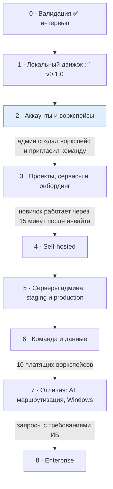

# Roadmap

> Переписан 16.10.2026 под модель владельца продукта ([vision](docs/product/vision.md)): админ, тимлиды и разработчики с правами; настройки воркспейса и веб-панель — на сервере Devopus; воркспейс → проекты (продукты) → приложения (репозитории) и сервисы проекта, подключённые к приложениям; проекты разворачивают агенты на ПК (позже — и на серверах админа для staging и production); всё через `devopus`, потом то же в веб-панели. Порядок работ в коде — [план рефакторинга](docs/refactoring-plan.md).

Этапы открываются **критерием**, а не датой.

**Веб-панель** повторяет CLI с отставанием не больше одного этапа: что появилось командой на этапе N, к концу этапа N+1 есть и в веб-панели, с теми же правами.

---

## 0 · Валидация ✅

Интервью закрыты ([итоги](docs/stage-0/findings.md)): тимлиды хотят, чтобы окружением команды управлял один человек и у всех оно было одинаковым; онбординг — «вошёл, поставил, работаешь». Осталось: **5 пилотных команд** (LOI) — с этапа 3.

## 1 · Локальный движок ✅

Готово, релиз [v0.1.0](https://github.com/amalychev/devopus/releases/tag/v0.1.0) ([план](docs/stage-1/plan.md)). Исполнитель на машине, на котором стоит всё остальное:

- агент и локальная панель службами; `brew` / `curl` / `.deb` / `.rpm`;
- окружение из описания стека: контейнеры, хуки, прокси с HTTPS на `*.localhost`, CA, DNS;
- фичи: worktree, свои контейнеры и копии баз из золотой копии, сон и пробуждение;
- импорт `docker-compose.yml`.

Сейчас стек описывается файлом `workspace.yaml`; с этапа 3 агент берёт настройки из воркспейса, а работа без воркспейса уходит.

## 2 · Аккаунты и воркспейсы

**Цель:** без входа `devopus` ничего не делает; админ создаёт воркспейс на сайте Devopus и приглашает команду с ролями. Всё сначала проверяем локально на Mac (письма с кодом — в лог); домен, хостинг и почту выбираем, когда будет что показать.

- **Auth** — отдельный сервис ([ADR-0014](adr/0014-auth-service.md), [auth.md](docs/architecture/auth.md)):
  - `devopus register` — email и одноразовый код; админ выбирает тарифный план (сейчас только Free);
  - `devopus login` — email и код, браузер с PKCE или device flow; `logout`, `whoami`, `auth sessions`, `auth revoke`;
  - access JWT 15 минут, refresh с ротацией; сессия живёт, пока ей пользуются; refresh-токен в Keychain.
- **Сервер воркспейса** — «пульт» ([ADR-0016](adr/0016-workspace-server.md)): воркспейсы, участники, роли, права, инвайты, аудит. Одна общая инсталляция Devopus; код сразу готов к self-hosted.
- **Роли и права** ([ADR-0015](adr/0015-roles-and-permissions.md), [roles.md](docs/product/roles.md)): один админ на воркспейс (с передачей владения), тимлиды проектов, разработчики; права сверх роли; проверка на каждом запросе.
- **Инвайты:** роль задаётся сразу; админ приглашает тимлидов и разработчиков, тимлид — разработчиков в свои проекты.
- **CLI:** `workspace create/list/use/show/transfer`, `invite …`, `member …`; все прочие команды требуют входа.
- **Агент** входит от имени пользователя.

**Критерий перехода:** админ создал воркспейс и пригласил команду; права работают и в CLI, и при прямых вызовах API.

## 3 · Проекты, сервисы и онбординг

**Цель:** главный сценарий продукта. Админ и тимлиды управляют настройками, у разработчиков окружение повторяется на ПК само. Новичок работает через **15 минут** после инвайта.

- **Проекты и приложения:** проект — продукт (`project create drive`), приложения — репозитории (`app add drive backend --repo …`); импорт проекта из `docker-compose.yml`.
- **Каталог сервисов** с версиями и настройками: php, nodejs, python, mysql, postgres, redis, typesense, queue, cronjob, mailpit. Сервис существует в проекте и подключается к одному или нескольким приложениям (одна база на `backend` и `admin`). `service add/set/rm/list/link`.
- **Настройки на сервере** ([ADR-0013](adr/0013-config-on-workspace-server.md)): неизменяемые версии, история, откат; `project config show` в YAML.
- **Агент получает настройки с сервера** и поднимает проекты, к которым у пользователя есть доступ; изменения раскатываются всем автоматически. Код клонируется с git-доступом самого разработчика.
- **Личные переопределения:** `devopus.yaml` в папке проекта (в git не попадает), по праву `overrides.use` и политике проекта; видны как расхождения (`devopus drift`).
- **Секреты** с E2E-шифрованием ключом воркспейса ([ADR-0009](adr/0009-secrets-key-distribution.md)).
- **Режим без воркспейса уходит:** `init`, `validate`, `export`, `schema` убираются; для отладки — демо-воркспейс.
- **Веб-панель** этапа 2: вход, воркспейсы, участники, инвайты, права.

**Критерий перехода:** в пилотной команде новичок от инвайта до открытой страницы проекта — меньше 15 минут; изменение версии сервиса тимлидом доходит до всех без их действий.

## 4 · Self-hosted

**Цель:** «пульт» — настройки и веб-панель — на своём сервере, для тех, кто опасается утечки данных.

- `devopus server install/upgrade/status/backup/uninstall` на Ubuntu 24.04+ (Docker, systemd); регистрация сервера в Auth.
- План **Self-hosted** при регистрации и в настройках воркспейса.
- **Веб-панель** этапа 3: проекты, сервисы, настройки, расхождения.

**Критерий перехода:** пилотная команда работает с self-hosted «пультом».

## 5 · Серверы админа: staging и production

**Цель:** те же настройки разворачиваются на собственных серверах админа. Такой сервер — обычная машина с агентом.

- `devopus agent install --server` — системная служба с токеном устройства. ✅ R13 ([ADR-0019](adr/0019-admin-servers.md)): `devopus servers add` с одноразовым кодом, агент сервера применяет только подписанное.
- `devopus env create staging|production --project …` — публичный адрес, настоящие сертификаты (ACME), обновление без простоя, откат. ✅ staging (R14a, [ADR-0020](adr/0020-public-environments.md)): подписанный публичный домен, сертификат Let's Encrypt от агента; production — R14b.
- Для production — подтверждение изменений и отдельное право; модель безопасности (риск R20).

## 6 · Команда и данные

- Снапшоты данных для онбординга с маскированием.
- Превью-ссылки (Tunnel) с правами доступа; callback-брокер для OAuth и вебхуков.
- Платные планы, биллинг.
- Аудит в веб-панели, уведомления об изменениях настроек.

**Критерий перехода:** 10 платящих воркспейсов.

## 7 · Отличия: AI, маршрутизация, Windows

- MCP-сервер для AI-агентов (`devopus mcp`): создать фичу, URL, логи.
- Contextual Isolation: маршрутизация между проектами по W3C Baggage.
- Фичи из Jira / Linear / GitHub Issues; автоочистка по вебхуку мержа.
- Windows через WSL2.

## 8 · Enterprise

- SSO/SAML через Auth как брокер; Auth внутри self-hosted инсталляции (без интернета).
- Роль «только чтение», если попросят; расширенный аудит, политики образов и сервисов.
- SOC 2 Type II.

---

## Что меняется в коде

Код v0.1.0 — локальный движок — остаётся основой. Меняется то, откуда он берёт описание стека и кто им управляет. Подробно — [план рефакторинга](docs/refactoring-plan.md).

| Сейчас (v0.1.0) | Станет | Этап |
|---|---|---|
| Команды работают без входа | Вход обязателен; токены в Keychain; код выхода 5 без права | 2 |
| `workspace.yaml` в репозитории — источник правды; `devopus init` / `up` в папке | Настройки с сервера воркспейса; `devopus up` поднимает проекты воркспейса; режима без воркспейса нет | 3 |
| «Проект» = весь стек, «модуль» = часть; воркспейса нет | «Проект» — тот же; «модуль» → «приложение»; над проектами — воркспейс ([словарь](docs/product/glossary.md#переход-от-модели-этапа-1)) | 2 |
| Рантайм — поле модуля (`runtime: php:8.3`); воркеры и cron — поля модуля | Сервисы проекта типов `php`, `nodejs`, `queue`, `cronjob` с версиями, подключённые к приложениям | 2–3 |
| `.env.secrets` рядом с `workspace.yaml` | Секреты воркспейса с E2E | 3 |
| `overrides.allowed` в `workspace.yaml` | Политика проекта + личный `devopus.yaml` + право `overrides.use` | 3 |
| Агент получает состояние от локального CLI | Агент держит исходящее соединение с сервером воркспейса; локальный API остаётся для CLI и панели | 3 |
| Агент — только служба пользователя | Плюс системная служба на сервере админа (`--server`) | 5 |
