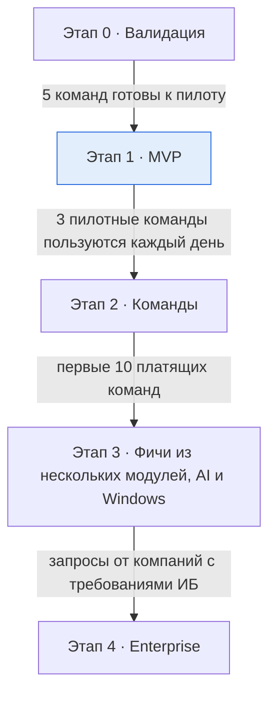

# Roadmap

Пять этапов от валидации до enterprise; каждый следующий открывается **критерием**, а не датой. Сроки сознательно не указаны — они зависят от размера команды.

Порядок технических работ внутри этапов: **сначала изоляция** (Docker, git, БД), **затем стабильная маршрутизация**, **потом оптимизация** (общие сервисы, W3C Baggage).

## Приоритеты технических проблем

| Приоритет | Смысл | Этапы |
|---|---|---|
| **P0** | Без решения продукт не работает или теряет данные | MVP |
| **P1** | Важно для ценности продукта | MVP – 2 (исключение: Windows — этап 3) |
| **P2** | Командный и enterprise-слой | 3 – 4 |

| Проблема | Приоритет | Этап |
|---|---|---|
| Порты 80/443, IPv6, привилегированные порты | P0 | 1 |
| Резолвинг `*.localhost` (хост и контейнеры) | P0 | 1 |
| Изоляция Docker | P0 | 1 |
| Клонирование БД, золотая копия, миграции | P0–P1 | 1 |
| HTTPS и локальный CA | P1 | 1 |
| Windows и WSL2 | P1 | 3 (перенесён с этапа 2 — разгрузить этап 2) |
| Маршрутизация между модулями по baggage | P2 | 3 (прототип — 0) |

---

## Этап 0 · Валидация

**Цель:** подтвердить боль, цену и техническую реализуемость рискованных частей.

- Интервью с 20 командами; проверка цены и главной боли: **онбординг или параллельные фичи**.
- Прототип CLI: `workspace.yaml` → стек на `*.localhost` с HTTPS.
- Технические прототипы рискованных частей (см. [docs/stage-0-plan.md](docs/stage-0-plan.md)): изоляция, клон Postgres/MySQL на ext4 и APFS, Contextual Isolation через Envoy + baggage, порты/DNS на macOS и Linux.
- Решение по открытым ADR: лицензия, место хранения конфига, клонирование MySQL.

**Критерий перехода:** 5 команд готовы к пилоту.

## Этап 1 · MVP

**Цель:** ценность ядра для одного разработчика. Детали — [specs/mvp-prd.md](specs/mvp-prd.md). **Идёт:** готовы M1–M3 из 9 вех — [docs/stage-1/plan.md](docs/stage-1/plan.md).

- Агент для macOS и Linux; privileged helper. *(каркас агента — ✅ M2; на macOS helper для портов не понадобился — Envoy контейнером, M3; Linux и установка — M9)*
- ✅ `workspace.yaml` v1, JSON Schema, импорт/экспорт docker-compose. *(M1)*
- Фичи с worktree и своим хостом; маршрутизация по путям; Simple Isolation.
- Изоляция Docker; порты, DNS, CA; HTTP-режим. *(M3: Envoy + xDS/SDS, CA, CoreDNS, порты и режимы конфликта, `doctor` — ✅ M3; HTTP-режим — позже)*
- Клон БД (золотая копия), миграции на клонах.
- Усыпление/пробуждение/бюджет; удаление с проверкой коммитов.
- Простая веб-панель для одного разработчика + CLI.

**Не входит осознанно:** Windows, командные воркспейсы, секреты, межсервисная маршрутизация по заголовкам, превью-ссылки, биллинг.

**Критерий перехода:** 3 пилотные команды пользуются каждый день.

## Этап 2 · Команды

**Цель:** монетизируемый командный слой (тариф Team).

- Облако: Core, Agent gateway, протокол агент ↔ сервер, облачная веб-панель (PWA).
- Воркспейсы, роли, инвайты, device flow, отзыв устройств.
- Онбординг с метрикой time-to-first-page в панели.
- E2E-секреты, доставка ключа на новое устройство, ротация.
- Контроль расхождений, overrides, двусторонний синк конфига с git (GitHub App).
- Снапшот для онбординга: `devcorb snapshot build` с маскированием из `workspace.yaml` в CI клиента, шифрование ключом команды, хранение в S3; актуальный + предыдущий для отката (см. [data.md](docs/architecture/data.md#снапшоты-team-и-business)).
- Tunnel: публичные превью-ссылки на окружения (`pay-123.team.<домен>.dev`) со сроком жизни и правами доступа; wildcard-TLS через DNS-01. Закрывает обещание тарифа Team, доступ к окружениям на удалённых устройствах (VPS, сервер команды) и открытие окружения с телефона.
- На входе Tunnel Envoy с первого дня удаляет внешний baggage-ключ фичи — чтобы этап 3 не открыл уязвимость.
- Тариф Team, биллинг через Stripe.
- Аудит-лог (заложить контроль под SOC 2).

**Критерий перехода:** первые 10 платящих команд.

## Этап 3 · Фичи из нескольких модулей, AI и Windows

**Цель:** ключевое отличие от конкурентов.

- Contextual Isolation: межсервисная маршрутизация по W3C Baggage, защита заголовка, проверка распространения через OTel, очереди с префиксом.
- MCP-сервер для AI-агентов (Claude Code, Codex).
- Автоусыпление и автоочистка по вебхуку мержа на всех устройствах.
- Callback-брокер поверх Tunnel: разводит OAuth callback'и и вебхуки внешних сервисов по фичам.
- Создание фич из Jira / Linear / GitHub Issues.
- Windows через WSL2 (двухкомпонентный агент: служба Windows + агент в WSL2).

**Критерий перехода:** запросы от компаний с требованиями безопасности.

## Этап 4 · Enterprise

- SSO/SAML, расширенный аудит-лог, политики образов.
- Управление снапшотами: история с retention, именованные снапшоты, обязательные политики маскирования воркспейса, сканер ПДн, аудит скачиваний.
- Self-hosted панель и шлюзы через Helm.
- Аудит SOC 2 Type II.
- Тарифы Business и Enterprise.

---

## Сквозные потоки работ

| Поток | 0 | 1 | 2 | 3 | 4 |
|---|---|---|---|---|---|
| Агент (ядро reconcile) | прототип | ✔ | облачный режим | MCP | политики |
| Сеть (порты, DNS, CA) | прототип mac/linux | ✔ | Tunnel | Windows, callback-брокер | — |
| Данные | прототип клонов | золотая копия | снапшот онбординга | — | управление снапшотами, сканер ПДн |
| Маршрутизация | прототип contextual | пути + simple | — | contextual | — |
| Облако | — | — | Core + gateway + Tunnel | — | Helm |
| Безопасность | модель угроз | helper, CA constraints | E2E, device flow, аудит, доступ к превью, заголовок на границе Tunnel | заголовок на границе внутри сети | SSO, SOC 2, пентест |
